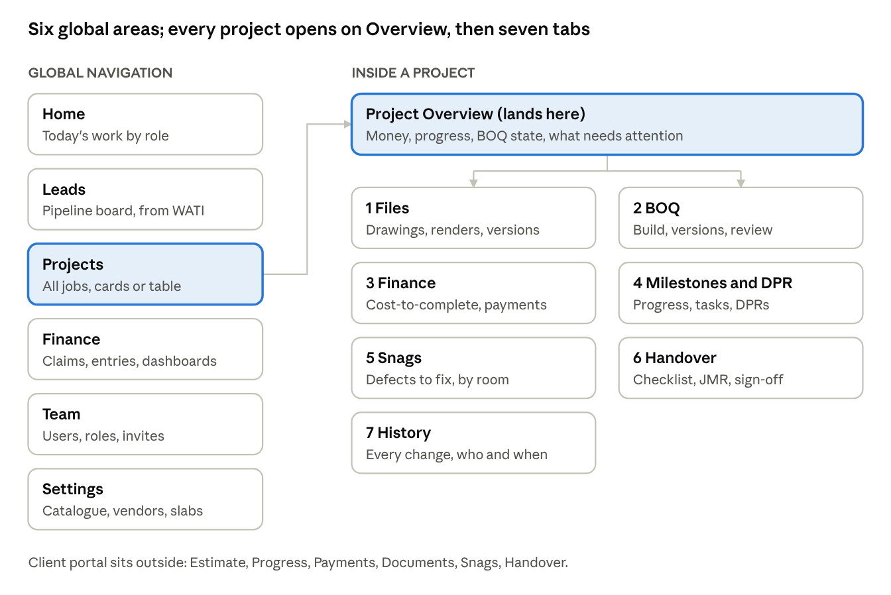
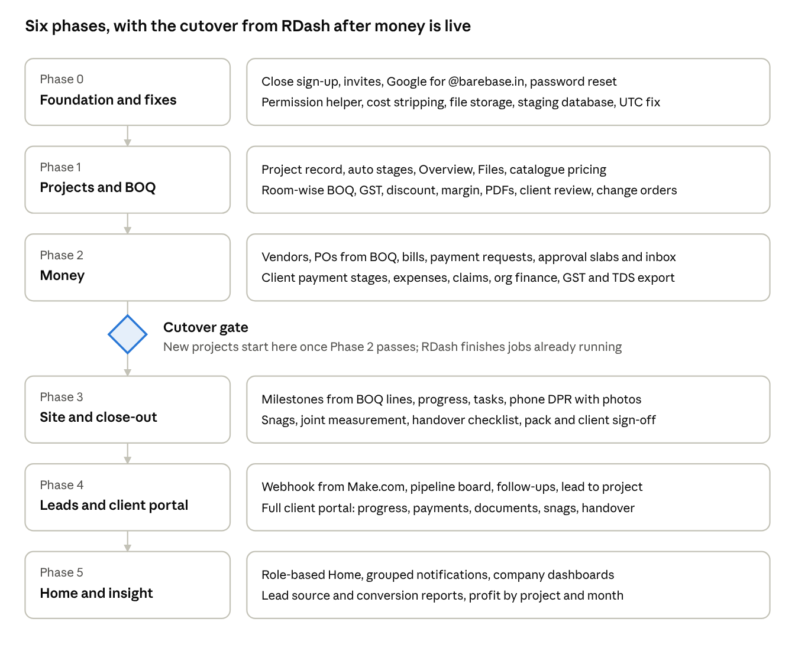

# Barebase Studio OS — Product Spec

Oct 8, 2026 · @Krishna

## 1. Vision and how to read this

We are turning minERP into Barebase's one internal platform: leads, projects, BOQs, money, site work and handover in a single tool that feels as simple as the BOQ builder. Every number comes from the BOQ, every rupee goes through an approval, and every screen can be used by a designer or site supervisor without training.

**Who this is for.** The developer building minERP. It says what to build, how each screen behaves, and how we will know it is done. Where a choice is still open, it is marked **Decision needed** and listed in section 23.

**What it builds on.**

- **minERP** (erp.fabrum.org) is the codebase. Keep its stack, item catalogue, BOQ versions, project members, task board, client review link and history log.
- **RDash** (what Barebase uses today) is the reference for breadth. We copy what the team actually uses and fix what it gets wrong. The full teardown deck is the background reading.

**How each module section is laid out.** What it is for · who uses it · screens · fields · rules · what the user sees when things go wrong · acceptance checks. Sections 17 to 21 hold the shared data model, permissions, formulas, design system and quality bar that every module follows.

**Words used in this spec.**

| Term | Meaning |
| --- | --- |
| BOQ | Bill of quantities: the priced list of everything we will build for a project, grouped by room |
| Line | One row of a BOQ (e.g. Master bedroom wardrobe, 8 × 7 ft) |
| Selling rate | What the client pays per unit. Shown to clients |
| Cost price | What it costs Barebase per unit. Internal only, never shown to clients |
| Version | A frozen copy of a BOQ at a moment (sent, approved) |
| Change order | A recorded change to a line the client already approved |
| PO | Purchase order to a vendor |
| DPR | Daily progress report from site |
| Snag | A defect found on site that must be fixed before handover |
| JMR | Joint measurement record: quantities measured on site with the client |
| Slab | An amount range that decides who must approve (e.g. above ₹50,000 needs the COO) |

## 2. Product principles

Ten rules decide every design argument. When a feature request conflicts with one, the rule wins unless Krishna overrides it in writing.

1. **As simple as the BOQ builder.** A new designer should build and send a BOQ in their first hour with no training. One primary action per screen, plain words, no jargon labels.
2. **The BOQ is the spine.** Budgets, purchase orders, progress, snags, billing and margin all hang off BOQ lines. Nothing is typed twice.
3. **Money is safe by design.** A payment cannot be marked paid before it is approved. There is no setting to turn this off. Large amounts are shown in words. Spending above budget raises a warning.
4. **Margin is private.** Cost price is hidden by default and removed on the server for anyone without permission. It never reaches a client view, a client PDF or a browser that should not see it.
5. **One progress number.** Progress is measured on BOQ lines, weighted by value. Milestones and the project percentage roll up from that. No separate Gantt to keep in sync.
6. **Status moves itself.** The project stage changes when the work happens (BOQ approved, first PO raised, handover signed), not when someone remembers to change a dropdown.
7. **Money in one place per project.** A project's Finance tab holds everything: client receipts, vendor payments, expenses and profit. No hunting across tabs.
8. **Fast on site.** A DPR, snag or expense can be logged on a phone in under 60 seconds, including photos. Every page loads in under 1.5 seconds.
9. **Opinionated, not configurable.** Barebase's workflow is built in. Settings exist only for what genuinely varies: approval slabs, categories, templates, letterhead.
10. **Nothing is lost.** Every change is in the history log with who, when, before and after. Deactivated users keep their records. Approved scope is never overwritten silently.

## 3. Starting point: minERP today

minERP has a sound BOQ and catalogue core; it is missing everything commercial and everything after the BOQ. This table is the gap list from the 8 October 2026 audit.

| Area | minERP today | Action |
| --- | --- | --- |
| Sign-up | Open public registration | **Fix first.** Remove /register. Admin invites only; Google sign-in limited to @barebase.in |
| Roles | 5 roles; only "History access" can be set | Replace with the permission model in section 18, enforced on the server |
| Passwords | No reset, no change, admin types the password | Invite email with set-password link; reset by email; change on Profile |
| Projects | Client, property, description; status stuck on Active | Full project record and automatic stages (section 6) |
| Item catalogue | 253 items, separate materials, finishes, units with dimension types; CSV import | Keep. Add selling rate + cost price, default scope text, HSN, GST %, CSV export (section 7) |
| BOQ | Versions, category sections, L × B × H, live totals | Keep. Add room sections, custom items, rate override, GST, discount, margin, scope text, notes, photos, PDFs (section 8) |
| Client review | Password link; approve, request change, reject per line | Keep. Add diff against last approved, automatic change orders, internal review screen |
| Tasks | Board with 6 statuses, due dates, assignees | Keep. Attach tasks to milestones (section 13) |
| History | Before → after log | Keep. Fix: times shown in UTC instead of India time |
| Vendors | "Coming soon" | Build (section 10) |
| Finance, DPR, snags, files, leads | None | Build (sections 9 to 15) |
| Speed | 2.5 to 9.3 s page loads | Target under 1.5 s (section 21) |
| Data checks | 9-digit phone accepted; duplicate item names look identical in pickers | Validate phones, GSTIN, PAN, email; show material and finish beside every item name |

**Bugs to fix before new work starts:** open registration, UTC timestamps in History, phone validation, identical item names in the BOQ picker, property name not editable, project status not changeable.

## 4. Users and roles

Six internal roles and two external ones. A person has one org role; on each project they can also hold a project role (e.g. "Lead designer" on Villa 33, "Designer" elsewhere). What each role may do is in section 18.

| Role | Who at Barebase | What they come to the tool for |
| --- | --- | --- |
| Admin | Krishna, Founder | Everything: settings, users, approval slabs, all projects and money |
| COO | Ridhi | Approve payments, expenses and POs; watch every project's progress and profit |
| Finance | Finance team (with the CA) | Record payments, reconcile, GST and TDS exports, reimbursement payouts |
| Design lead | Mansi | Own BOQs and design files across projects; review designers' work; send to clients |
| Designer | Keertan and team | Build BOQs, upload drawings, raise tasks, log expenses on their projects |
| Pre-sales | Anamika, Ananya | Work leads, book site visits, draft the first BOQ, hand won leads to design |
| Site supervisor (optional) | On-site staff | Log DPRs, progress, snags, site expenses from a phone; never sees cost price |
| Client (external) | Each project's client contacts | Review and approve BOQs; see progress, DPRs, payment stages, snags, handover documents |

**Rules**

- Accounts are created by an Admin only, by invite email. No public sign-up.
- Google sign-in works only for @barebase.in accounts that already exist.
- Deactivated users cannot sign in, but every record they created stays.
- Clients never get an account. They reach their project through a secure link (section 16).
- Contractors and vendors do not log in in v1. **Decision needed:** whether contractors should upload site photos later.

## 5. Navigation and screen map



The left sidebar holds six global areas; opening a project always lands on Project Overview, with seven tabs in the agreed order. Org-wide Finance (claims, reimbursements, office spends) is separate from each project's Finance tab, which ties to that project's BOQ. Approvals and notifications sit in the top bar on every page. Tabs a user may not access are hidden.

## 6. Projects and Project Overview

A project is the home for everything about one client job. Opening it lands on Project Overview, which answers "how is this job doing?" in one screen.

### Projects list

- **Views:** cards (default) and table. Filters: stage, lead designer, city, "my projects". Search by project, client or code.
- **Table columns:** code, project, client, stage, lead designer, contract value, received %, progress %, next milestone date, last activity.
- **Who sees what:** Admin, COO and Finance see all projects. Others see projects they are a member of. **Decision needed:** should the Design lead see all projects?
- **New project** opens a short form. Only three fields are required; the rest can be filled later.

### Project fields

| Field | Required | Notes |
| --- | --- | --- |
| Project code | Auto | Format BB-YY-NNN, e.g. BB-26-014. Never reused |
| Project name | Yes | Property name, e.g. Villa 33, Adarsh Palm Acres. Editable |
| Client | Yes | Pick an existing client or create one inline (name, phone, email, billing address, GSTIN optional) |
| Lead designer | Yes | A user; becomes a project member automatically |
| Site address | No | Full address + Google Maps link |
| Project type | No | Residential / Commercial |
| Scope | No | Multi-select: Design, Interiors, Civil, Turnkey |
| Area | No | sq ft |
| Estimated value | No | ₹, before a BOQ exists. Replaced by the approved BOQ total once there is one |
| Key dates | No | Site visit, design freeze target, execution start, handover target |
| Team | No | Users + project role. Members get access |
| Source lead | Auto | Filled when the project comes from a won lead |
| Notes | No | Free text |

### Stages (automatic)

| Stage | Moves here when |
| --- | --- |
| Design | Project created |
| Quotation | First BOQ version is sent to the client |
| Approved | Client approves a BOQ version (fully or partly) |
| Execution | First PO is raised, or a user marks execution started |
| Snagging | Every milestone is complete, or a user starts the snag walk |
| Handover | Handover checklist is signed by the client |
| Closed | Final payment received and Finance marks the project closed |

Side states set by hand from the project menu: **On hold**, **Lost**, **Reopened**. Each change is logged with who and when. A user with Edit project permission can move a stage back, with a reason.

### Project Overview screen

- **Header:** project name, code, client, stage bar showing the seven stages with the current one highlighted, lead designer avatar.
- **Money card:** contract value · received · outstanding · spent · margin (margin only for users who may see cost). One link: "Open Finance".
- **Progress card:** overall progress %, next milestone and its due date, overdue tasks count.
- **BOQ card:** current version, status, client review state (e.g. "14 of 22 lines approved").
- **Attention list:** up to five items needing action: pending approvals, overdue payments from client, open snags, unanswered client comments.
- **Recent activity:** last 10 history entries.

### Project tabs

Overview · Files · BOQ · Finance · Home budget · Milestones & DPR (tasks and daily reports live inside) · Snags · Handover · History. This is the agreed order. Tabs a user cannot access are hidden, not greyed out.

### Acceptance checks

- [ ] Creating a project with only name, client and lead designer works in under 30 seconds.
- [ ] Sending the first BOQ version moves the stage to Quotation without anyone touching the stage.
- [ ] A designer who is not a member cannot open the project by URL (server returns not found).
- [ ] Project code is unique and sequential within the year.

## 7. Item catalogue (rate card)

The catalogue is minERP's strongest part: keep its structure and add pricing depth. Every BOQ line starts from a catalogue item or is a custom line.

### What stays from minERP

- Separate lists for **Categories** (17), **Materials** (45), **Finishes** (87) and **Units** (66 shared + own).
- Each unit declares its dimensions: None, L, L × B, or L × B × H. This decides which measurement boxes appear on a BOQ line.
- Default categories added to every new BOQ.
- CSV import.

### Item fields

| Field | Required | Who can see | Notes |
| --- | --- | --- | --- |
| Item code | Auto | All | Category code + number, e.g. WD-014 (wardrobes). Used for CSV matching |
| Name | Yes | All | e.g. "Loft" |
| Category | Yes | All |  |
| Material | No | All | From the materials list |
| Finish | No | All | From the finishes list |
| Unit | Yes | All | Drives measurement boxes |
| **Selling rate** (₹/unit) | Yes | All internal | Renamed from "Rate". What the client pays |
| **Cost price** (₹/unit) | No | Cost viewers only | Renamed from the unused "Price" column. Internal only |
| GST % | Yes | All internal | Default 18 |
| HSN / SAC | No | All internal | Printed on tax documents later |
| Default scope text | No | All | Client-facing description copied onto the BOQ line when added |
| Image | No | All | Reference photo |
| Active | Yes | Admin | Inactive items stay on old BOQs but cannot be added to new ones |

### Screens and behaviour

- **Catalogue table:** filters for category, material, finish, unit; search; 50 rows per page (minERP shows 10). Cost price column visible only to cost viewers.
- **Margin column** for cost viewers: (selling − cost) ÷ selling, shown as %. Red below 15%. **Decision needed:** the warning threshold.
- **Inline editing** like minERP's add row, plus bulk edit of selling rate by % for a filtered set (e.g. raise all Wardrobes by 8%).
- **CSV import and export.** Import shows a preview: new items, changed items (old → new values), unchanged, and errors, before anything is saved. Items match on item code.
- **Duplicate names:** wherever an item is picked, show it as Name · Material · Finish · Unit · ₹rate so 14 "Loft" entries are told apart.
- **Rate changes never rewrite existing BOQs.** A line copies the rate and scope text at the moment it is added.
- **History:** every rate change is logged (who, when, old → new).

### Who can edit

Admin and Design lead edit items and rates. Everyone else views. Only cost viewers see or edit cost price.

### Acceptance checks

- [ ] Importing a CSV of 253 items shows a correct preview and saves only after confirmation.
- [ ] A designer without cost permission gets no cost data in any API response, not just a hidden column.
- [ ] Changing an item's rate leaves sent and approved BOQs unchanged.

## 8. BOQ

The BOQ is where the job is priced, agreed with the client and later executed against. It must feel instant: pick a room, add items, see totals update as you type.

### Layout of the Build screen

- **Left:** room list (Living, Kitchen, Master bedroom…), each with its subtotal. Drag to reorder. "+ Add room".
- **Centre:** the selected room's lines, editable in place like a spreadsheet. Tab moves between cells; Enter adds a new line.
- **Right (sticky summary):** subtotal, discount, taxable value, CGST, SGST (or IGST), grand total, amount in words. Cost viewers also see total cost and margin % and ₹.
- **Top bar:** version number and status, "Save version", "Preview client view", "Download PDF" (client / internal), "Send to client".

### Sections

Sections are **rooms** (minERP groups by category today; change this). Each line still carries its category, so totals by category are available in a toggle and on the internal PDF. A room has a name and an optional note.

### Line fields

| Field | Notes |
| --- | --- |
| Item | Search picker across the catalogue, filtered to the room's likely categories first. Shows Name · Material · Finish · Unit · ₹rate |
| Custom line | "+ Custom item" adds a free-text line with its own unit, rate and cost. Flagged "Custom" on the internal view |
| Category, material, finish | Copied from the item; editable on the line |
| Measurements | Boxes appear by unit: L (rft), L × B (sq ft), L × B × H (cu ft). Feet with decimals; inches allowed as 8'6" |
| Quantity | Calculated from measurements. Can be typed over (an oddly shaped area); a small "edited" marker shows the override |
| Count | How many identical units (two identical wardrobes = one line, count 2). Billed quantity = quantity × count |
| Selling rate | Copied from the catalogue. Can be overridden per line; overrides show a marker and are listed in the internal PDF |
| Cost price | Copied from the catalogue. Cost viewers only |
| GST % | From the item; editable per line |
| Amount | Billed quantity × selling rate. Read-only |
| Scope of work | Long client-facing description; prefilled from the item's default scope |
| Internal note | Never shown to the client ("client wants walnut sample first") |
| Photo | One reference image, compressed on upload, stored in file storage (not the database) |

Line actions: duplicate, move to another room, delete (with undo for 10 seconds), drag to reorder.

### Pricing rules

- Discount: either % or a fixed ₹ amount, on the whole BOQ. Optional per-line discount is **not** in v1.
- GST: on by default. Same state as Barebase (Karnataka) → CGST + SGST, each half the rate. Other state → IGST. The client's state comes from their billing address.
- Lines can have different GST rates; the summary shows tax per rate band.
- All money is stored as exact decimals (paise), never floating-point. Rounding rules are in section 19.

### Versions and statuses

| Status | Meaning | Editable? |
| --- | --- | --- |
| Draft | Being built | Yes |
| Sent | Shared with the client for review | No. Editing creates a new draft version from it |
| Approved | Client approved every line | No |
| Partly approved | Some lines approved, some rejected or flagged | No |
| Superseded | A newer version was sent | No |

- A version is a frozen snapshot of every room and line. Old versions always open exactly as they were sent.
- "Main version" (minERP's "Set as primary") is the one that drives budgets and progress. Only an approved or partly approved version can become main.
- Compare any two versions side by side: added, removed and changed lines with old → new values.

### Sending and client review

1. "Send to client" picks the version and the client contacts, shows the email preview, and creates a link.
2. The client opens the link, confirms their email (a 6-digit code sent to it), and sees the estimate in the client view (section 16).
3. Per line the client can **Approve**, **Request change** (with a comment), or **Reject** (with a reason). "Approve all" is available. When done they press "Submit review".
4. The team gets a notification. The **Client Review** screen lists every line with the client's verdict and comment beside it, and lets the designer edit the line right there.
5. Saving those edits creates the next draft version, and sending it shows the client only what changed since what they last approved.

### Change orders

When a line the client already approved is changed, deleted or added to after approval, the tool records a **change order** automatically: line, room, what changed (old → new), who, when, reason (required), and the ₹ impact. Change orders appear on the BOQ, in History and on the client view. Approved scope is never overwritten silently.

### Client-visible columns

Per BOQ, toggles for what the client sees: material, finish, measurements, quantity, rate. Amount and scope text are always shown. Cost, margin and internal notes are never shown, regardless of toggles.

### PDFs

- **Client PDF:** letterhead, project and client details, version and date, room-by-room lines with the visible columns, room subtotals, discount, tax breakdown, grand total in figures and words, terms and exclusions, signature block.
- **Internal PDF:** the same plus cost price, margin per line and per room, overrides and custom lines flagged.
- Layout and fonts as in the mock-ups.

### Productivity features

- Import lines from another project's BOQ (pick rooms or lines).
- Duplicate a whole project's BOQ as the start of a new one.
- Room templates (e.g. "Standard 3BHK kitchen") saved from any room. **Decision needed:** v1 or later.
- Autosave every change; a "Saved" indicator in the top bar.
- If two people open the same draft, the second sees "Mansi is editing this BOQ" and edits are locked to the first until they leave or 10 minutes pass idle.

### Acceptance checks

- [ ] A 60-line, 8-room BOQ can be built without leaving the Build screen.
- [ ] Totals, GST split and amount in words match the formulas in section 19 for the same inputs to the paisa.
- [ ] A sent version cannot be edited by any user, including via the API.
- [ ] Changing an approved line without a reason is blocked; with a reason it creates a change order.
- [ ] The client PDF contains no cost or note data (checked by searching the PDF text).

## 9. Files and design versions

One place per project for drawings, renders, contracts and documents, with versions and a simple review state. RDash's design module is the model, simplified: Barebase uploaded files there but never used the five-state review, so v1 has three states.

### Folders (default, per project)

2D drawings · 3D renders · Client documents · Contracts and POs · Site photos · Handover. Admins can add or rename folders in Settings for all new projects.

### File behaviour

- Upload by drag and drop or from a phone camera. Any file type; images and PDFs preview in the browser.
- **Versions:** uploading a file with the same name into the same folder (or choosing "Upload new version") stacks it as V2, V3… The list shows the latest; history shows all, each downloadable.
- **Review state:** Draft → Approved internally → Shared with client. Design lead or Admin approves. Only "Shared with client" files appear in the client view.
- **Design freeze:** a project-level action (Design lead or Admin) that records the date, freezes the current approved set, and links it to the BOQ version approved at that time. Later uploads after freeze are flagged "after freeze".
- Comments on a file, with @mentions.
- Line photos from the BOQ and DPR photos also live in file storage and are browsable here under Site photos.

### Storage

Files go to object storage (Vercel Blob or Cloudflare R2), never into the database as data URLs. Each file record holds key, name, size, type, folder, version, uploader, date, state. Download links are signed and expire after 10 minutes.

### Acceptance checks

- [ ] A 50 MB PDF uploads from a laptop and a 10 MB photo from a phone on 4G.
- [ ] A client link never exposes a Draft file, even if its URL is guessed.
- [ ] Design freeze records the linked BOQ version and date in History.

## 10. Vendors and purchase orders

Vendors are the carpenters, fabricators, suppliers and contractors Barebase pays. A PO is raised from approved BOQ lines, so the order rate sits right beside the selling rate and the margin on every item is visible before money is committed.

### Vendor master (Organisation › Vendors)

| Field | Required | Notes |
| --- | --- | --- |
| Vendor code | Auto | VEN-NNN |
| Name | Yes | Business name |
| Trade tags | Yes | Multi-select: Carpentry, Civil, Electrical, Plumbing, Painting, Fabrication, Supplier, Labour, Other |
| Contact person, phone, email | Phone required | Phone validated as 10-digit Indian mobile |
| PAN | No | Format-checked (ABCDE1234F) |
| GSTIN | No | Format-checked; first two digits give the state, used for CGST/SGST vs IGST |
| Bank details | No | Account name, number, IFSC (format-checked). Visible to Admin and Finance only |
| Address | No |  |
| TDS section | No | e.g. 194C contractor. Default rate pulled from section 19 |
| Status | Yes | Active / Inactive / Blacklisted. Blacklisted vendors cannot get new POs |
| Documents | No | PAN card, GST certificate, cancelled cheque |

Vendor page tabs: Details · POs · Bills · Payments (across all projects) · Ledger (ordered, billed, paid, balance).

### Purchase orders (Project › Finance › POs)

1. **Create PO** from the project. Pick the vendor, then pick lines from the main BOQ version (filter by room or category), or add free lines (e.g. labour lot).
2. Each PO line shows: item, room, BOQ quantity, quantity already ordered, quantity on this PO, **order rate**, amount, and for cost viewers the selling rate and margin on that line.
3. Header fields: PO number (auto, BB-26-014/PO-03), date, delivery or start date, site address, payment terms (from a template, editable), notes, attachments.
4. **Submit for approval.** Approval follows the PO slab (section 12). Approved POs can be downloaded as a PDF on the letterhead and shared with the vendor by WhatsApp or email from the user's own device.
5. PO statuses: Draft → Pending approval → Approved → Sent → Partly billed → Fully billed → Closed. Cancelled is allowed until the first payment.

### Rules

- Ordered quantity above the BOQ quantity is allowed but shows a warning and needs a reason.
- An order rate above cost price shows a warning; above selling rate it is blocked unless an Admin overrides with a reason.
- After any payment against a PO, it can only be changed by a **PO revision** (new revision number, old one kept, re-approval required).
- Vendor bills (section 11) are recorded against a PO, or as "no PO" for small items.

### Acceptance checks

- [ ] Raising a PO from 12 BOQ lines takes under two minutes.
- [ ] The PO PDF never shows the selling rate or margin.
- [ ] A PO with a payment against it cannot be edited, only revised.

## 11. Finance

Finance is the most-used part of RDash today (vendor payments and site expenses), so it must be the most reliable part of this tool. Two places: **Project Finance** for one job, tied to its BOQ, and **Org Finance** for everything not tied to a project. Underneath, both write to one ledger so company-wide reports are a single query.

### Project Finance tab: four sub-tabs

**1. Summary (cost-to-complete).** The screen RDash does not have. One row per room, plus a project total:

| Column | Source |
| --- | --- |
| Sold | Main BOQ version at selling rate |
| Budget | Main BOQ version at cost price (cost viewers only) |
| Ordered | Approved POs |
| Paid | Vendor payments + project expenses |
| Left to spend | Budget − paid |
| Billed to client | Client payment requests raised |
| Received | Client receipts |
| Outstanding | Billed − received |

Margin shown three ways: planned (sold − budget), committed (sold − ordered), realised (received − paid). Alerts at the top: ordered above budget on a room, client stage due but not billed, payment overdue from client. Click any number to drill down to its transactions.

**2. Client payments.**

- **Payment schedule:** stages as % of contract value (e.g. 10% booking, 40% design freeze, 40% on milestones, 10% handover), each optionally linked to a milestone. Template from Settings, editable per project.
- When a linked milestone completes, the stage becomes **Due** and Finance is notified.
- **Payment request** to the client: stage, amount (base + GST), due date. Shown in the client view.
- **Receipt:** date, amount, mode (UPI, NEFT/RTGS, cheque, cash), reference no., proof upload. Partial receipts allowed.
- **Decision needed:** whether the tool issues numbered GST tax invoices, or only records invoices issued by the CA.

**3. Vendors & bills.** POs (section 10), vendor bills and payments.

- **Bill:** vendor, PO (or "no PO"), bill no., bill date, taxable value, GST, TDS, total, upload of the bill. A bill cannot exceed the PO's remaining value without a reason.
- **Payment request:** against a PO advance, a bill, or no PO. Amount, due date, note. Goes for approval by slab.
- **Payment entry:** only after approval. Date, amount, mode, UTR/reference, proof. The "Mark paid" button does not exist on an unapproved request.

* **Vendor ledger for this project:** one row per vendor working on the project, with trade, number of POs, ordered, billed, paid and due, plus a total row. Selecting a vendor shows its POs and every bill (number, date, amount, TDS, status: pending approval, approved to pay, paid with date). Direct labour and site expenses without a PO appear as their own row so the totals reconcile with the Summary tab. The vendor's own page (section 10) shows the same ledger across all projects.

**4. Expenses.** Project-related spends (site materials, transport, labour advances), entered as in Org Finance below with the project already set.

### Org Finance (global nav › Finance)

| Page | Who sees it | What it holds |
| --- | --- | --- |
| Submit claim | Everyone | Form for a reimbursement or expense |
| My claims | Everyone | Your own claims with status, approver, paid date |
| New entry | Everyone | Record a vendor or office transaction; non-admins see only their own entries |
| Approvals | Approvers | Shortcut to the approvals inbox (section 12), finance items only |
| Pending reimbursements | Admin, Finance | Approved claims awaiting payout, grouped by person, with total owed to each |
| All transactions | Admin, Finance | Every entry, filters by project, person, category, GST rate, status, date |
| Dashboard | Admin, COO, Finance | Spend and revenue by day, month, quarter, year; by project, category, person |
| GST & TDS | Admin, Finance | Monthly input GST, output GST, TDS deducted; CSV export for the CA |

### The entry form (claims, expenses, office spends)

- **Type:** Reimbursement (I paid) or Company expense (company paid).
- **Project:** a project or "Office / no project".
- **Category:** Printouts, Client food, Cab to site, Fuel, Site material, Transport, Labour, Office supplies, Software, Rent, Utilities, Other. Admin can edit the list.
- **Price mode:** GST-inclusive (enter final amount; taxable value and GST back-calculated) or GST-exclusive (enter base; GST added). Both fill the other fields live.
- **GST rate:** 0, 5, 12, 18 or 28%. Every entry carries a GST tag, including 0%.
- Vendor (optional), date, description, bill photo (required above ₹500; **Decision needed** on the threshold).
- Fuel claims: km and rate per km option.

### Safeguards against wrong amounts

- Every amount field shows the figure in Indian words as you type ("₹10,00,000 — ten lakh rupees").
- Amounts above ₹1,00,000 on a claim, or above the project's remaining budget, ask for a second confirmation showing the words again.
- A warning when the same amount, vendor and date already exist (possible duplicate).
- Pending entries can be edited by the person who created them or an Admin. Approved entries are locked; corrections are reversing entries, never edits.

### Acceptance checks

- [ ] Entering ₹1,18,000 GST-inclusive at 18% fills taxable ₹1,00,000 and GST ₹18,000.
- [ ] A payment request cannot reach Paid without passing every approval level, tested through the API.
- [ ] A designer sees only Submit claim, My claims and their own New entry records.
- [ ] Dashboard totals for a month equal the sum of that month's approved ledger entries.
- [ ] GST export for a month opens in Excel with one row per entry and correct CGST/SGST/IGST columns.

## 11A. Home budget and client purchases

Clients also buy things Barebase neither supplies nor pays for: appliances, loose furniture, rugs, light fixtures, curtains, art. Designers need these in the tool for two reasons: site work depends on them (a hob must arrive before the granite cut-out), and the client wants one view of what the whole home costs against what was planned at the start. This is a new project tab, **Home budget**, between Finance and Milestones & DPR, with two sub-tabs.

### Plan vs actual

- At kick-off, the designer and client agree a **whole-home budget** split into categories: Barebase interiors (the BOQ) plus client categories (Appliances, Loose furniture, Lighting fixtures, Rugs, Curtains and blinds, Art and décor, and any custom ones), plus an optional **Contingency** reserve. Each category gets a planned amount. The plan is frozen with a date ("Planned at kick-off, 1 Aug") and can be re-baselined later with a reason; earlier baselines are kept.
- As items are selected, each category shows **Selected** (sum of chosen items, or the approved BOQ at selling price for Barebase's row), **Difference** in ₹ and %, and **Paid** by the client.
- **Forecast** = selected amount for categories already chosen + planned amount for categories not yet chosen. The contingency absorbs overruns: "over budget" = forecast − total plan, shown only when the contingency is used up.
- A bar per category shows plan and selected on the same scale, green within plan, red over plan.
- An alert names the categories over plan and by how much.

### Client purchases

One row per thing the client buys.

| Field | Notes |
| --- | --- |
| Item | e.g. Refrigerator and dishwasher |
| Room(s) | From the BOQ rooms |
| Category | One of the Home budget categories |
| Client's supplier | Free text; the client pays them directly |
| Price | Planned amount until chosen, then the selected price |
| Status | Not started → Selecting → Selected → Ordered (with expected delivery) → Delivered → Installed |
| Needed by | The date site work needs the item, or a decision about it |
| Dependency | Link to a Barebase milestone, as either **Needs** (the item waits for Barebase work, e.g. rugs need the final clean) or **Blocks** (Barebase work waits for the item or a decision, e.g. light fixture weights before the false ceiling closes) |
| Paid by client | Optional amount, for the budget view |
| Notes, photo, link | Product link or quote image |

- **Dependency status** is calculated: On track, At risk (needed within 3 days and not yet ordered or decided), Overdue (needed-by date passed). At risk and Overdue items appear on Project Overview's attention list and notify the lead designer.
- **Timeline:** a strip showing Barebase milestones as bars and client deliveries and decisions as markers, with a Today line, so the designer sees clashes at a glance.
- Client purchases never create POs, ledger entries or approvals; Barebase money and client money stay separate.

### Client portal

A new **Budget** tab shows the client their whole-home forecast against the plan, each category's plan vs selected, and a "We need from you" box listing their overdue and at-risk decisions. The Barebase row shows the approved estimate at selling price only. Barebase's cost, margin, vendors and vendor bills are never shown.

### Who can do what

Designers and the design lead on the project create and edit the plan and client purchases; Admin and COO can too. The client can view, and can mark a purchase as ordered or delivered from the portal (**Decision needed**).

### Phase

Vendors & bills ships in Phase 2 with Finance. Home budget ships in Phase 3, because dependencies need milestones.

### Acceptance checks

- [ ] Forecast for the sample project equals selected + unselected plans, and the over-budget figure appears only after the contingency is used up.
- [ ] A client purchase whose needed-by date passes without an order turns Overdue and appears on Project Overview.
- [ ] The client Budget tab contains no cost, margin, vendor names or vendor amounts (automated test).
- [ ] Changing the kick-off plan requires a reason and keeps the earlier baseline.

## 11B. Proforma invoices, PO creator, and Sent & due

The team sends proformas to clients and POs to vendors every week, and things slip when nobody tracks what was sent and what is owed. Both documents are created in one screen each, and every document that leaves Barebase is tracked until it is paid, done or closed.

### Proforma invoice creator (Project › Finance › New proforma)

- **Left: three steps.** 1) What it is for: pick an open payment stage, an approved change order, or a custom amount. Stages already invoiced show their existing proforma number and send a revised copy. 2) Payment due: 7 days, 15 days, or on receipt. 3) Send to: the client contacts, with copies to the COO and Finance.
- **Right: live preview** on the letterhead: legal entity, GSTIN and PAN; proforma number (PI-YY-NNNN), date and due date; bill-to and place of supply; the line with SAC code; CGST + SGST (or IGST for another state); total in figures and words; bank and UPI details; signatory; and the line "This is a proforma invoice, not a tax invoice".
- **Send to client** emails a PDF and a portal link and creates the tracker entry. **Download PDF** is always available.
- When the client pays against a proforma, Finance records the receipt (section 11). The proforma shows Paid or Part paid. Whether the tool then issues the GST tax invoice depends on decision 5.

### Purchase order creator (Project › Finance › New PO)

This is the screen for the PO flow in section 10.

- Pick the vendor, then **tick BOQ lines** from the main version. Each line shows quantity, order rate (editable), selling rate, and margin %. The last two are for cost viewers only and never appear on the PO PDF.
- Totals with CGST and SGST and the amount in words update live. The room's remaining budget is shown, and a red warning appears if the PO goes over it, which then requires a reason.
- Pick a payment terms template. Show who will approve, based on the slab.
- **Submit for approval** sends the PO through the approval engine (section 12). Once approved, it is emailed to the vendor and tracked.

### Sent & due tracker (Finance › Sent & due, company-wide; also filtered per project)

- One row for every document sent: proformas, POs, BOQ versions, and later tax invoices. Each row shows number, type, project, recipient, sent date, amount, due date, live status (sent, opened, acknowledged, part paid, paid, work done, billed) and a **flag**.
- **Flags**, recalculated every day at 9 am:
  - Overdue: past due and not paid, done or reviewed. Shown in red, and notifies the sender and Finance.
  - Due soon: within 3 days. Shown in amber.
  - On track, or Closed.
- What "due" means per type: proforma = payment due date; PO = work or delivery date; BOQ = review-by date (default 7 days after sending).
- Filters: Open, Overdue, Due this week, Proformas, Purchase orders, All. Cards show count sent this month, amount owed by clients, overdue count, and due this week.
- **One-click follow-up** on each open row (payment reminder, chase vendor, ask to confirm, review reminder). It sends by email and portal or WhatsApp link, and logs the reminder on the document.
- Open and acknowledge times come from the portal and PO links.

### Billing due: proformas drafted from milestones

Every client payment stage is linked to the milestone that earns it. When that milestone comes due, the system drafts the proforma itself, so billing takes one click instead of a form.

- **Link.** On the project's payment schedule, each stage (for example "Stage 3 · 25% of contract") picks one milestone. A stage with no milestone stays manual and uses the normal proforma creator.
- **Trigger (Org Settings, one rule for the company).** Either *3 days before the milestone's due date* (recommended, leaves time to check) or *when the milestone is marked complete* (bills only finished work). A nightly job at 6 am India time checks every linked stage.
- **What gets drafted.** A proforma in `draft` status with everything filled in: client, project, stage name, percentage × contract value, SAC, CGST/SGST or IGST by place of supply, amount in words, due date from the payment terms, and the next PI number (reserved only when it is sent).
- **Who hears about it.** Finance and the project's lead designer get a notification: "Stage 3 proforma for Hebbal Business Loft is ready to send."
- **Billing due queue (Finance › Billing due).** One row per drafted proforma: project, milestone and its state, stage, amount incl. GST, status. Each row has **Send proforma**; selecting a row shows the proforma preview with **Send to client** and **Edit before sending** (opens the proforma creator pre-filled). **Send all ready** sends every drafted row after one confirm.
- **Nothing goes to a client automatically.** A person always presses Send. Sending moves the proforma into Sent & due, where the normal overdue flags and reminders take over.
- **Milestones screen.** Gets a Client billing column showing each linked stage's state (drafts on 12 Nov · drafted · sent PI-26-0048 · paid · overdue), linking to the queue or the tracker.
- **Changes after drafting.** If the milestone date moves, the draft's due date moves with it. If the contract value changes (approved change order or BOQ revision), the draft recalculates and shows "Updated after change order CO-02". A cancelled stage deletes its unsent draft.
- **Permissions.** Finance and Admin can send. Lead designers can see the queue for their own projects and edit drafts, but cannot send unless the org setting allows it.
- **Create proforma, any time.** Every milestone-linked stage that hasn't been billed has a **Create proforma** button in three places: the project's Finance › Client payment schedule (drafts it inline with Send to client and Edit before sending), the Milestones screen's Client billing column, and Billing due (**Create now** on stages that aren't due yet). The automatic draft is a safety net for when nobody presses it.

### Acceptance checks

- [ ] A proforma for a ₹83,467 stage shows CGST ₹7,512, SGST ₹7,512 and a total of ₹98,491, with matching words.
- [ ] The PO PDF contains no selling rate or margin (text check).
- [ ] A proforma not paid by its due date shows Overdue the next morning and notifies the sender and Finance.
- [ ] Every reminder sent appears in the document's history with date, channel and sender.
- [ ] With the "3 days before" rule, a stage linked to a milestone due on 21 Oct shows a ready draft in Billing due on 18 Oct, with correct GST and amount in words, and Send moves it to Sent & due in one click.
- [ ] No proforma is ever emailed to a client without a person pressing Send.

## 12. Approvals

One approval engine serves every money item, and one inbox shows every approver what is waiting for them. The rule that matters most: **nothing is paid until it is approved, and there is no setting to change that.**

### What needs approval

Vendor payment requests · client payment discounts or write-offs · purchase orders and PO revisions · expense claims and reimbursements · company expenses · BOQ versions above a discount threshold (optional; **Decision needed**).

### Slabs (set by Admin in Settings › Approvals)

Each item type has amount slabs, and each slab has one or more levels. Each level names one or more users; any one of them can approve that level. Example only; the real amounts are a **Decision needed**:

| Item type | Up to ₹25,000 | ₹25,001 to ₹2,00,000 | Above ₹2,00,000 |
| --- | --- | --- | --- |
| Vendor payment | COO | COO | COO, then Founder |
| Purchase order | Design lead | COO | COO, then Founder |
| Expense / claim | Design lead or COO | COO | COO, then Founder |

### Rules

- A request moves level by level. Rejecting at any level ends it; the requester sees the reason and can edit and resubmit, which restarts approval.
- **Hold** pauses a request with a note; the requester is told.
- Nobody approves their own request. If the requester is the only approver at a level, it goes to the next level, or to an Admin if none.
- There is no "bypass lower levels" option and no auto-approval.
- Changing an amount after any approval restarts approval from level 1.
- Every action (submit, approve, reject, hold, resubmit, pay) is logged with who, when and note.

### Approvals inbox (global, tick icon in the top bar with a count)

- List: type icon, title ("Vendor payment · Ravi Carpentry · Villa 33"), amount in figures and words, requester, waiting since, level (e.g. 1 of 2).
- Clicking opens the full request on the right: attachments (bill, PO), project budget context (budget, ordered, paid, left), history of this request, comment thread.
- Buttons: **Approve**, **Reject** (reason required), **Hold** (note required). Approve takes one click; there is no second confirmation below ₹2,00,000.
- Filters: type, project, amount range, waiting over 2 days.
- Requests waiting more than 48 hours are highlighted, and the approver gets a daily reminder.

### Acceptance checks

- [ ] A ₹3,00,000 vendor payment needs COO then Founder; Finance cannot record payment after only the COO approves.
- [ ] Editing the amount of a half-approved request resets it to level 1.
- [ ] The requester can never see an Approve button on their own request.

## 13. Milestones, tasks, progress and DPR

Execution tracking has one progress number, measured where the work is: on BOQ lines. Milestones group lines and roll their progress up; tasks handle everything that is not a BOQ line; the DPR assembles itself from the day's updates. This avoids RDash's split, where the schedule said 0% while site progress said 65%.

### Milestones

- A milestone is a named stage with planned start and end dates, e.g. Civil and demolition · False ceiling · Electrical first fix · Carpentry install · Painting · Final fix and clean.
- Template from Settings; editable per project. Reorder by drag.
- Each milestone covers a set of BOQ lines (pick by room and category; one line belongs to one milestone).
- **Milestone progress** = value-weighted progress of its lines. **Project progress** = value-weighted progress of all lines in the main BOQ version.
- Milestone status: Not started → In progress → Complete (automatic at 100%) · Delayed (automatic when today is past the planned end and progress is under 100%).
- A milestone can be linked to a client payment stage (section 11). Completion makes that stage Due.
- The milestone view is a simple list with a progress bar and dates, plus an optional timeline strip. No dependencies or critical path in v1.

### Updating progress

- **Progress screen:** BOQ lines grouped by milestone or room, each with a slider (0, 25, 50, 75, 100%) or a typed %, plus "Add photo".
- Quantity-based update is available for lines measured in units (e.g. 120 of 400 sq ft tiled).
- Each update stores who, when, old → new %, and photos.
- Progress is weighted by the line's selling amount, so a ₹4,00,000 kitchen counts more than a ₹6,000 light point.

### Tasks (minERP's board, kept)

- Keep the board: Open, In progress, In review, On hold, Completed, Cancelled.
- Add: link to a milestone (optional), priority (Normal / High), attachments, checklist items, comments with @mentions.
- Tasks are for non-line work: "get tile sample approved", "chase electrician for quote".
- "My tasks" across all projects on the Home screen.

### Daily progress report (DPR)

The site supervisor or designer files one DPR per site visit day, on a phone, in under 60 seconds.

| Part | How it is filled |
| --- | --- |
| Date, project, filed by | Automatic |
| Progress updates | Pulled automatically from today's line updates; can add more right here |
| Work done today | Short text (voice-to-text on phone) |
| Photos | Up to 20, compressed on upload, each with an optional caption and room tag |
| Manpower | Count by trade (carpenters, painters, electricians, helpers); prefilled from yesterday |
| Materials received | Optional free text |
| Blockers | Optional text; any blocker notifies the lead designer |
| Tomorrow's plan | Optional text |
| Share with client | Toggle (default on). Client sees a cleaned version: no manpower, no blockers |

- DPR list per project, newest first, with a calendar showing days with and without DPRs.
- PDF per DPR and a weekly summary PDF (all DPRs for a week, progress change, photos).
- **Decision needed:** whether DPRs are also sent to the client by WhatsApp (via WATI) or only shown in the client view.

### Acceptance checks

- [ ] Setting one ₹1,00,000 line to 50% in a ₹10,00,000 BOQ moves project progress by exactly 5 points.
- [ ] A DPR with 6 photos files from a phone on 4G in under 60 seconds.
- [ ] Completing a milestone linked to a payment stage marks the stage Due and notifies Finance.
- [ ] The client view of a DPR never shows manpower or blockers.

## 14. Snags, joint measurement and handover

Close-out is where RDash is weakest: it has snags but no measurement record and no handover. These three together take a project from "work done" to "client signed off and fully paid".

### Snags

- **Raise a snag** from a phone: photo (required), room (from the BOQ rooms), BOQ line (optional), title, category (Carpentry, Civil, Electrical, Plumbing, Painting, Finish, Other), severity (Minor / Major / Critical).
- **Assign:** a person (internal) or vendor, plus a committed fix date.
- **Status:** Open → Fixed (by assignee, with an "after" photo) → Verified (by lead designer) → Closed. "Won't fix" needs a reason and Design lead approval.
- Code SNG-NNN per project. List filters: room, status, assignee, overdue. A progress bar shows % closed.
- Clients can raise snags from the client view (section 16); these arrive as Open with "Raised by client".
- **Snag walk mode:** a phone screen to go room by room, adding snags quickly one after another.
- Overdue snags (past committed date) appear on the Overview attention list.

### Joint measurement (JMR)

For lines billed on measured quantity (false ceiling, painting, flooring, civil), the team and the client measure on site and agree the final quantity before billing.

- Create a JMR for selected BOQ lines. Each row shows BOQ quantity, then **measured quantity** (with L × B entry), difference, and ₹ impact at the selling rate.
- The client confirms the JMR from the client view (or a signed photo is uploaded).
- Confirming a JMR creates a change order for every line whose quantity changed, so the BOQ, billing and margin all update from it.

### Handover

- **Handover checklist** from a template in Settings, e.g. all snags closed · final clean done · keys and remotes handed over · appliance manuals and warranty cards uploaded · as-built drawings uploaded · care guide shared · final payment received.
- Items tick automatically where the tool knows (snags closed, payment received); others are ticked by the lead designer, with a photo or file where relevant.
- **Handover pack:** a PDF generated from the project: summary, final BOQ, change orders, warranties list, care guide, contacts for support.
- **Client sign-off:** the client accepts handover in the client view, with name and date recorded. This moves the project to Handover stage.
- **Warranty period:** start date and length (default 12 months, **Decision needed**). Snags raised during warranty are tagged "Warranty".

### Acceptance checks

- [ ] A snag cannot be closed without an "after" photo.
- [ ] Confirming a JMR with three changed quantities creates three change orders with correct ₹ impact.
- [ ] The handover checklist cannot be completed while any snag is open.

## 15. Leads

Leads already arrive through Meta Lead Ads → Make.com → WATI (WhatsApp) → Slack. The tool does not replace that pipeline; it receives every lead from it, gives pre-sales one board to work them, and turns a won lead into a project with no retyping.

### How leads arrive

- **Webhook endpoint** (`POST /api/leads/inbound`) that Make.com calls for each new lead. Authenticated with a secret header; rejects anything else.
- Payload: name, phone, email, city, source (Meta form, website, WhatsApp, referral), campaign, form answers (space type, budget, new or renovation), WATI contact id.
- Duplicate check on phone number: a repeat lead is attached to the existing lead as a new enquiry, not created twice.
- Manual "New lead" form for walk-ins and referrals.

### Lead fields

Name · phone (required, validated) · email · city · locality · source · campaign · property type · space type (e.g. 3BHK full home, kitchen only) · budget range · new build or renovation · possession date · assigned to · stage · next follow-up date · lost reason · notes.

### Stages (board columns)

New → Contacted → Qualified → Site visit booked → Proposal sent → Negotiation → Won / Lost. Lost needs a reason (budget, timeline, chose competitor, not reachable, not a fit). Drag cards between columns; every move is logged.

### Working a lead

- **Speed matters:** the card shows time since the lead arrived; leads untouched for 30 minutes turn amber, 2 hours red, and the assignee is notified.
- Activity timeline: calls, WhatsApp, notes, visits, stage changes. "Log call" and "Open WhatsApp" (wa.me link to the number) in one tap.
- **Next follow-up** date required on every stage except Won and Lost. Overdue follow-ups show on the pre-sales Home screen.
- **One quote path:** "Start BOQ" from a lead creates a draft project and its first BOQ. This draft BOQ is the proposal; there is no separate lead quotation like RDash's.
- **Won** converts the lead: the draft project becomes a real project, client details are carried over, the lead links to it, and the assigned lead designer is notified.

### Reports

Leads by source and campaign, conversion % by stage, average time to first contact, won value by month, lost reasons. These feed back into marketing decisions.

### Acceptance checks

- [ ] A test lead posted to the webhook appears on the board within 5 seconds.
- [ ] Posting the same phone twice creates one lead with two enquiries.
- [ ] Winning a lead with a draft BOQ creates the project with the BOQ attached and no fields retyped.

## 16. Home, notifications and client portal

### Home (replaces minERP's empty welcome page)

Home answers "what do I need to do today?" and changes by role. Every card links to the item.

| Role | Home shows |
| --- | --- |
| Everyone | My tasks due today and overdue · items waiting for my approval · my recent projects · unread mentions |
| Admin, COO | All projects by stage with progress and outstanding amounts · approvals waiting · cash this month in and out · projects over budget · client payments overdue |
| Finance | Payments approved and not yet paid · reimbursements owed by person · client receipts due this week · GST month status |
| Design lead, Designer | My projects · BOQs awaiting client review · client comments to answer · files awaiting my approval |
| Pre-sales | New leads untouched · follow-ups due today · site visits this week |
| Site supervisor | Today's projects · DPR not yet filed today · snags assigned to me |

### Notifications

- In-app bell with unread count, and email for important events. **WhatsApp notifications via WATI: Decision needed.**
- Events: approval waiting for you · your request approved, rejected or held · client submitted a review · client comment · task assigned or due · snag assigned · blocker in a DPR · lead assigned or untouched 30 minutes · payment stage due.
- Each user can turn email off per event type. In-app is always on.
- Grouping: several events on the same item within 10 minutes become one notification ("3 comments on Villa 33 BOQ"). This avoids RDash's 99+ noise.

### Client portal

Clients reach their project through a secure link; there is no account to create.

- **Access:** a link per client contact. First open on a device asks for a 6-digit code sent to their email (or WhatsApp later). The device is remembered for 30 days. Links can be revoked and reissued.
- **What the client sees** (tabs): Estimate (the BOQ version shared, with review controls) · Progress (overall %, milestones, DPR feed with photos) · Payments (schedule, what is due, what is received) · Documents (files marked Shared with client) · Snags (theirs and ours, with status; can raise new ones) · Handover (checklist status, pack download, sign-off).
- **Never shown:** cost price, margin, internal notes, manpower, blockers, vendor names and rates, draft files.
- Branded with the Barebase letterhead and design system. Works well on a phone.
- Every client action is logged in History with a "Client" badge.

### Acceptance checks

- [ ] A client link cannot open another project by changing any id in the URL.
- [ ] Every client API response is checked by an automated test for the absence of cost, margin and note fields.
- [ ] The COO's Home shows every pending approval without opening any project.

## 17. Data model

One Postgres database, every table scoped by `orgId`. Money is `Decimal(14,2)`, never float. Every table has `id` (cuid), `createdAt`, `updatedAt`, `createdById`. Deletes are soft (`deletedAt`) for anything money, BOQ or client-facing. Field lists below are the essentials; the developer may add technical fields.

| Area | Table | Key fields and links |
| --- | --- | --- |
| People | Organization | name, legalName, address, GSTIN, PAN, state, letterhead, default terms |
|  | User | name, email, phone, orgRole, active, googleLinked |
|  | ProjectMember | projectId, userId, projectRole |
| Leads | Lead | name, phone, email, city, source, campaign, formAnswers (json), stage, assignedToId, nextFollowUp, lostReason, projectId? |
|  | LeadActivity | leadId, type (call, whatsapp, note, visit, stage), text, at |
| Clients | Client | name, phone, email, billingAddress, state, GSTIN? |
|  | ClientContact | clientId, projectId, name, email, phone, token, revoked, lastSeenAt |
| Projects | Project | code, name, clientId, leadDesignerId, siteAddress, type, scope\[\], area, estimatedValue, stage, sideState, keyDates (json), leadId? |
| Catalogue | Category, Material, Finish, Unit | as minERP; Unit has dimensions (none, L, LB, LBH) |
|  | Item | code, name, categoryId, materialId?, finishId?, unitId, sellingRate, costPrice, gstRate, hsn, defaultScope, imageKey, active |
| BOQ | Boq | projectId, name, mainVersionId?, discountType, discountValue, gstOn, clientColumns (json), terms, lockedById?, lockedAt? |
|  | Room | boqId, name, note, position |
|  | Line | roomId, itemId?, isCustom, name, categoryId, material, finish, unit, dimL, dimB, dimH, qty, qtyOverride, count, sellingRate, rateOverride, costPrice, gstRate, scope, note, photoKey, position, milestoneId?, progressPct |
|  | Version | boqId, number, status, snapshot (json of rooms and lines), sentAt, approvedAt |
|  | LineReview | versionId, contactId, lineId, verdict (approved, change, rejected), comment |
|  | ChangeOrder | boqId, versionId?, lineId, kind (added, removed, modified), changes (json old → new), amountImpact, reason, source (edit, JMR) |
| Files | File | projectId, folder, name, key, size, mime, version, parentFileId?, state (draft, approved, shared), afterFreeze |
| Vendors | Vendor | code, name, tags\[\], contact, phone, email, PAN, GSTIN, state, bank (encrypted json), tdsSection, status |
|  | PurchaseOrder | projectId, vendorId, number, revision, status, date, terms, total |
|  | PoLine | poId, lineId?, description, qty, unit, orderRate, gstRate, amount |
| Money | LedgerEntry | projectId?, kind (client\_receipt, vendor\_bill, vendor\_payment, expense, reimbursement, reversal), category, vendorId?, poId?, payeeUserId?, priceMode, taxable, gstRate, cgst, sgst, igst, tds, total, date, mode, reference, status, paidAt |
|  | PaymentStage | projectId, name, pct, amount, milestoneId?, status (upcoming, due, requested, received) |
|  | PaymentRequest | projectId, direction (client, vendor), stageId?, poId?, billId?, amount, dueDate, status |
|  | Attachment | ownerType, ownerId, fileKey (bills, proofs) |
| Approvals | ApprovalRule | itemType, minAmount, maxAmount, levels (json: \[\[userIds\]\]) |
|  | ApprovalStep | itemType, itemId, level, approverId?, decision (approved, rejected, held), note, at |
| Execution | Milestone | projectId, name, position, plannedStart, plannedEnd, status |
|  | ProgressUpdate | lineId, fromPct, toPct, qtyDone?, photoKeys\[\], byId, at |
|  | Task | projectId, milestoneId?, title, description, status, priority, assigneeId, start, due, checklist (json) |
|  | Dpr | projectId, date, byId, workDone, manpower (json), materials, blockers, tomorrow, shareWithClient |
| Close-out | Snag | projectId, code, roomId, lineId?, title, category, severity, assigneeUserId?, assigneeVendorId?, committedDate, status, beforePhotoKey, afterPhotoKey, raisedByClient, warranty |
|  | Jmr, JmrLine | projectId, confirmedAt; lineId, boqQty, measuredQty, dims |
|  | HandoverItem | projectId, label, auto (bool), done, doneById, fileKey? |
| System | AuditEvent | orgId, projectId?, entityType, entityId, action, actorType (team, client, system), actorId, before, after, at |
|  | Notification | userId, type, entityType, entityId, read, at |

**Added for Home budget (section 11A)**

| Table | Key fields and links |
| --- | --- |
| BudgetPlan | projectId, baselineDate, reason, isCurrent |
| BudgetCategory | planId, name, owner (barebase, client, reserve), plannedAmount, position |
| ClientPurchase | projectId, categoryId, name, roomIds\[\], supplierText, price, priceIsSelected, status, expectedDelivery, neededBy, milestoneId?, dependencyType (needs, blocks), paidByClient, notes, photoKey, link |

**Added for proformas and the tracker (section 11B)**

| Table | Key fields and links |
| --- | --- |
| Proforma | projectId, number, paymentStageId?, changeOrderId?, description, sac, taxable, cgst, sgst, igst, total, dueDate, status (draft, sent, part\_paid, paid, cancelled), pdfKey |
| SentDocument | docType (proforma, po, boq\_version, tax\_invoice), docId, projectId, recipientType, recipientId, sentAt, sentById, channel, openedAt?, acknowledgedAt?, dueAt, dueKind (payment, delivery, review), status, flag (on\_track, due\_soon, overdue, closed) |
| Reminder | sentDocumentId, sentAt, sentById, channel, message |
| PaymentStage (changed) | adds milestoneId?, billingState (waiting, drafted, sent, paid), draftedProformaId?, draftedAt?. Org setting billingTrigger (before\_due\_3d, on\_complete) |

**Notes for the developer**

- The minERP BOQ tables migrate into Boq / Room / Line / Version. Existing categories become the default room names for old BOQs.
- `LedgerEntry` is the single source for every finance report. Project Finance and Org Finance are filtered views of it.
- Line rates and scope are copied at the moment of adding, never referenced live from Item.
- `LineReview.lineId` is a loose reference (no foreign key), so a client's verdict survives even if the line is later deleted.

## 18. Permissions matrix

Permissions are checked on the server on every request through one helper, `can(user, action, resource)`. Hiding a button is never the only protection. Cost price is removed from data in one central place before it leaves the server, for every user without the "see cost" permission.

"Own projects" means projects where the user is a member. ✓ = allowed, — = not allowed.

| Capability | Admin | COO | Finance | Design lead | Designer | Pre-sales | Site supervisor |
| --- | --- | --- | --- | --- | --- | --- | --- |
| See all projects | ✓ | ✓ | ✓ | Own (**decide**) | Own | Own | Own |
| Create project | ✓ | ✓ | — | ✓ | — | ✓ (from lead) | — |
| Edit project details, team | ✓ | ✓ | — | ✓ | — | — | — |
| See cost price and margin | ✓ | ✓ | ✓ | **decide** | — | — | — |
| Edit catalogue and rates | ✓ | — | — | ✓ | — | — | — |
| Build and edit BOQ drafts | ✓ | ✓ | — | ✓ | Own | Own (pre-win) | — |
| Send BOQ to client | ✓ | ✓ | — | ✓ | — | — | — |
| Change approved lines (change order) | ✓ | ✓ | — | ✓ | — | — | — |
| Upload files | ✓ | ✓ | — | ✓ | Own | Own | Own (site photos) |
| Approve files, freeze design | ✓ | — | — | ✓ | — | — | — |
| Create POs | ✓ | ✓ | — | ✓ | — | — | — |
| Manage vendors | ✓ | ✓ | ✓ | — | — | — | — |
| See vendor bank details | ✓ | — | ✓ | — | — | — | — |
| Submit claims and own entries | ✓ | ✓ | ✓ | ✓ | ✓ | ✓ | ✓ |
| Approve (per slab rules) | Per rules | Per rules | Per rules | Per rules | — | — | — |
| Record payments and receipts | ✓ | — | ✓ | — | — | — | — |
| See all transactions, dashboards, GST | ✓ | ✓ | ✓ | — | — | — | — |
| Update progress, file DPR | ✓ | ✓ | — | ✓ | Own | — | Own |
| Raise and fix snags | ✓ | ✓ | — | ✓ | Own | — | Own |
| Verify and close snags | ✓ | ✓ | — | ✓ | — | — | — |
| Leads board | ✓ | ✓ | — | View | — | ✓ | — |
| Users, roles, approval slabs, settings | ✓ | — | — | — | — | — | — |
| History log | All | All | Finance items | Own projects | Own projects | Own leads | Own projects |

**Added for Home budget and vendor ledger**

| Capability | Admin | COO | Finance | Design lead | Designer | Pre-sales | Site supervisor |
| --- | --- | --- | --- | --- | --- | --- | --- |
| See project vendor ledger and bills | ✓ | ✓ | ✓ | **decide** | — | — | — |
| View Home budget and client purchases | ✓ | ✓ | ✓ | ✓ | Own | — | Own (read) |
| Edit plan and client purchases | ✓ | ✓ | — | ✓ | Own | — | — |

**Rules**

- An approval is allowed only if the user is named at the current level and is not the requester.
- "Own" checks are made in the database query (filter by membership), not after loading data.
- Every permission refusal returns "not found" for items the user cannot see, so their existence is not revealed.
- Permission changes take effect on the next request; a deactivated user's open session stops working immediately.

## 19. Calculations and business rules

All formulas live in one shared module used by the screens, the PDFs and the server, so every place shows the same number. Each formula has unit tests with worked examples.

### BOQ line

- Quantity from dimensions: rft = L · sq ft = L × B · cu ft = L × B × H · Nos / lumpsum = typed. If the quantity is overridden, the typed value wins and dimensions are ignored.
- Billed quantity = quantity × count.
- Line amount = billed quantity × selling rate, rounded to 2 decimals.
- Line cost = billed quantity × cost price.

### BOQ totals

```latex
\text{Subtotal} = \sum \text{line amounts}
```

- Discount: % → subtotal × % ; fixed → the ₹ amount (cannot exceed subtotal).
- Discount is spread across lines in proportion to their amount, so GST is calculated on discounted values per GST rate.
- Taxable value = subtotal − discount.
- GST per rate band = taxable value in that band × rate. Same state: CGST = SGST = half each. Different state: IGST = full rate.
- Grand total = taxable value + total GST. Rounded to the nearest rupee on the client PDF, with the rounding shown as a line ("Round off ₹0.40").
- Margin ₹ = taxable value − total cost. Margin % = margin ₹ ÷ taxable value.

### GST-inclusive and exclusive entry

- Exclusive: GST = base × rate; total = base + GST.
- Inclusive: base = total ÷ (1 + rate); GST = total − base. Example: ₹1,18,000 at 18% → base ₹1,00,000, GST ₹18,000.

### TDS on vendor payments

TDS = taxable value × the vendor's TDS rate (e.g. 194C: 1% individual, 2% company). Net payable = bill total − TDS. Rates kept in Settings, not hard-coded, because they change. **Decision needed:** confirm sections and rates with the CA.

### Progress

```latex
\text{Progress} = \frac{\sum (\text{line amount} \times \text{line \%})}{\sum \text{line amount}}
```

The same formula applies to a milestone (its lines), a room (its lines) and the project (all lines of the main version).

### Project finance

- Sold = main version taxable value. Budget = main version total cost.
- Ordered = sum of approved PO lines (taxable). Paid = approved vendor payments + approved project expenses (taxable).
- Left to spend = budget − paid. Committed margin = sold − ordered. Realised margin = received (taxable) − paid.

### Numbering and formats

- Indian number format everywhere: ₹12,34,567.00. Amount in words in Indian style (lakh, crore).
- Dates DD MMM YYYY (08 Oct 2026). All times in India time (Asia/Kolkata), stored in UTC.
- Codes: projects BB-26-014 · POs BB-26-014/PO-03 · snags SNG-007 · vendors VEN-042 · payment requests PR-26-0001. Sequences never reuse a number, even after deletion.

## 20. UX and design system

The tool should look and feel like the "Warm Ledger" design: calm, paper-like, serious about numbers. Simplicity is a requirement, not a nice-to-have; every screen is reviewed against the rules below before it ships.

### Design tokens

| Token | Value | Use |
| --- | --- | --- |
| Brass | #9C7A3C | Primary buttons, active tab, links, highlights |
| Ink | #24231E | Body text, dark headers |
| Paper | #F4F1E8 | Page background |
| Line | #D8D1BF | Borders, table rules |
| Green | #465241 | Success, approved, money in |
| Red | #A8452F | Errors, rejected, overdue, money out warnings |
| Headings | Cambria / Georgia | Page and section titles |
| Body | System sans-serif | Everything else; numbers in tabular figures so columns align |

Keep minERP's theme switch (Light / Wood / Dark) only if every token above has a dark-mode equivalent; otherwise ship Light only in v1.

### Simplicity rules

1. **One primary action per screen**, in brass, top right. Secondary actions are plain buttons or in a ⋯ menu.
2. **Three clicks to anything** from Home: Home → project → tab.
3. **No tables wider than the screen.** At most 8 columns visible; more via a column picker. Status and amount always visible.
4. **Plain words.** "Send to client", not "Dispatch proposal". Labels say what happens.
5. **Forms ask only what is needed now.** Optional fields sit under "More details".
6. **Every list has an empty state** that says what it is and offers the first action ("No POs yet · Raise a PO from the BOQ").
7. **Errors say how to fix it** ("GSTIN should be 15 characters, like 29ABCDE1234F1Z5"), next to the field.
8. **Undo instead of confirm** for small deletes (10-second undo toast). Confirm dialogs only for irreversible actions and large amounts.
9. **Status chips use one vocabulary and colour per meaning** across the whole app (Draft grey, Pending brass, Approved green, Rejected red).
10. **Keyboard friendly** in the BOQ builder: Tab, Enter, arrow keys; / to search.

### Layout

- Global left sidebar (collapsible): Home, Leads, Projects, Finance, Team, Settings. Approvals tick, notifications bell and user menu top right.
- Inside a project: project header with stage bar, then tabs (section 6).
- **Phone:** every page works at 375 px wide. Site screens (DPR, progress, snags, expenses) are designed phone-first, with big touch targets (44 px) and camera upload.

### Reference designs

The design canvas "Barebase Platform — Homepage" (Home › Projects › Project Overview › BOQ) is the visual reference for these four screens. Other screens follow the same patterns.

## 21. Security, performance and quality

### Security

- No public sign-up. Invite-only accounts; Google sign-in restricted to @barebase.in and to accounts that already exist.
- Passwords hashed (bcrypt or argon2); minimum 10 characters; reset by emailed one-time link valid for 30 minutes.
- Sessions in httpOnly, secure cookies; checked on every request so deactivation is immediate.
- Rate limiting on login, client code entry and the leads webhook.
- Vendor bank details encrypted at rest; visible to Admin and Finance only.
- Secrets (database URL, auth secret, webhook secret, storage keys) only in environment variables, rotated before go-live. No secret in the repository or in screenshots.
- Staging and production use separate databases. Test data never enters production.
- Daily automated database backups with point-in-time recovery; a restore is tested once before go-live.

### Performance targets

| Measure | Target |
| --- | --- |
| Any page, first load on office broadband | Under 1.5 s |
| BOQ with 200 lines, open and edit | Under 2 s to open; edits reflect instantly |
| PDF of a 200-line BOQ | Under 5 s |
| Phone DPR with 6 photos on 4G | Under 60 s end to end |
| Leads webhook to board | Under 5 s |

No embedded BI dashboards. Charts are drawn natively from the app's own queries.

### Quality

- Automated end-to-end tests (Playwright) for every acceptance check in this spec, run on every pull request.
- Unit tests for every formula in section 19, with worked examples.
- A test that requests every client-facing endpoint and fails if cost, margin, notes or vendor rates appear.
- Every pull request is reviewed and merged by Krishna. Each release has a short changelog in plain words.
- Error tracking (e.g. Sentry) with alerts on new errors in production.
- A written user guide per module, updated with each release.

## 22. Build phases and acceptance



Phases run in order; each ships to staging, is tested by the team for one week, then goes to production. Money moves before site work because vendor payments are Barebase's heaviest daily workflow. A phase is done only when every acceptance check in its module sections passes, plus the exit checks below.

| Phase | Exit check (all must pass) |
| --- | --- |
| 0 Foundation and fixes | No public sign-up; every user on their own login; a designer's API responses contain no cost data; History shows India time; staging and production databases separate |
| 1 Projects and BOQ | Five real projects built end to end by the design team; client PDF totals match a hand check to the paisa; one BOQ sent, reviewed and revised through the client link |
| 2 Money | One month of real vendor payments and claims run through approvals in parallel with RDash, totals matching; no payment recorded without full approval; CA accepts the GST export |
| 3 Site and close-out | Two live projects tracked with daily DPRs for two weeks; one project snagged and handed over with client sign-off |
| 4 Leads and client portal | All Meta and WhatsApp leads land on the board for two weeks with no misses; one client uses the portal for progress and payments |
| 5 Home and insight | COO runs the weekly review from Home and dashboards alone, without opening RDash or a spreadsheet |

**Working agreement:** one pull request per feature, each linked to the section of this spec it implements, reviewed and merged by Krishna. Any change to this spec is made in this doc so it stays the single source of truth.

## 23. Open decisions

These choices change what gets built. The spec uses the default shown until Krishna decides; each is needed by the phase listed.

| # | Decision | Default in this spec | Needed by |
| --- | --- | --- | --- |
| 1 | Can the Design lead see all projects? | Own projects only | Phase 1 |
| 2 | Can the Design lead see cost price and margin? | No | Phase 1 |
| 3 | Approval slab amounts and approvers | Example table in section 12 | Phase 2 |
| 4 | One GSTIN or several billing entities? | One (Kanchan Integrated Property Development Co.) | Phase 2 |
| 5 | Does the tool issue numbered GST tax invoices, or only record the CA's? | Record only | Phase 2 |
| 6 | TDS sections and rates | 194C at 1% / 2%, confirmed with the CA | Phase 2 |
| 7 | Bill photo required above which amount? | ₹500 | Phase 2 |
| 8 | Catalogue margin warning threshold | 15% | Phase 1 |
| 9 | Discount above which % needs approval before sending a BOQ? | No approval | Phase 1 |
| 10 | Room templates in v1? | Later | Phase 1 |
| 11 | Who files DPRs: site supervisors, designers or both? | Both | Phase 3 |
| 12 | DPRs and notifications on WhatsApp via WATI? | In-app and email only | Phase 3 |
| 13 | Do contractors get upload-only access? | No | Phase 3 |
| 14 | Warranty period after handover | 12 months | Phase 3 |
| 15 | Run RDash in parallel until projects in flight finish? | Yes; new projects start here after Phase 2 | Phase 2 |
| 16 | Import data from another system, or start fresh? | Start fresh (decided) | — |

**Added 15 Oct with Home budget**

| # | Decision | Default in this spec | Needed by |
| --- | --- | --- | --- |
| 17 | Can the design lead see the project vendor ledger? | Yes, without bank details | Phase 2 |
| 18 | Can the client mark their purchases ordered or delivered from the portal? | Yes | Phase 3 |
| 19 | Default client categories and contingency % at kick-off | The 7 categories above; contingency 3% of the plan | Phase 3 |
