# Barebase Studio OS — UI & UX Spec

Oct 8, 2026 · @Krishna

Companion to the Barebase Studio OS product spec: this doc shows what every screen looks like, how people move through it, and gives the developer the tokens, routes, components and done criteria to build it.

## 1. The look and feel

The app should feel like a well-kept ledger on warm paper: calm, quiet, and exact about money. The Home screen below, from the approved design canvas, is the reference every other screen matches.

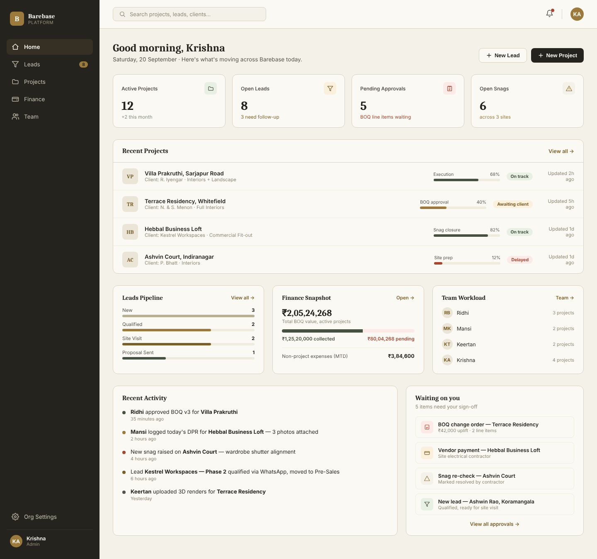

*Reference: Home, from the "Barebase Platform — Homepage" design canvas. Numbers and names in all reference images are sample data.*

**Three words to design by:** calm (few colours, lots of space), exact (numbers aligned and in Indian format), obvious (one clear next action on every screen).

**How to use this doc.** Section 2 is the visual system. Section 3 is the app frame. Section 4 shows how people move through the main jobs. Section 5 shows each screen. Sections 6 to 8 are the rules for behaviour, phones, words and review. The product spec holds the fields and business rules; this doc holds what the screens look like and how they behave.

### Developer quick start

- **Where to build:** inside the minERP codebase (Next.js App Router on Vercel). Keep its existing styling approach; the tokens in section 2 are given both as CSS variables and as a Tailwind theme, so either works. Do not add a component library such as MUI or Ant; the components here are small enough to own.
- **What each section gives you:**

| Section | You get |
| --- | --- |
| 2 Foundations | Tokens as code, status-to-colour map, component APIs with states |
| 3 Shell | Route map, layout tree, renames from current minERP URLs |
| 4 Flows | Status machines: every status, transition, who triggers it, side effects |
| 5 Screens | Build notes per screen: route, components, data, states, permissions, done-when |
| 6 Patterns | How each shared behaviour is implemented |
| 7 Mobile, words | Breakpoints, formatters with test cases |
| 8 Done | Definition of done and the pull request template |
| 9 Implementation | Build order, folder layout, testing |

- **Source of truth:** the product spec decides fields and business rules; this doc decides look and behaviour; the reference images decide layout. If two disagree, ask Krishna before building.
- **Sample data:** every name and amount in the images is made up. Use the same sample project (Villa Prakruthi, client R. Iyengar) in the seed data and in tests, so screenshots can be compared side by side.

## 2. Design foundations

Six colours, two typefaces and a small set of components build every screen. Build these once as shared components before any module screen, so the whole app stays consistent.

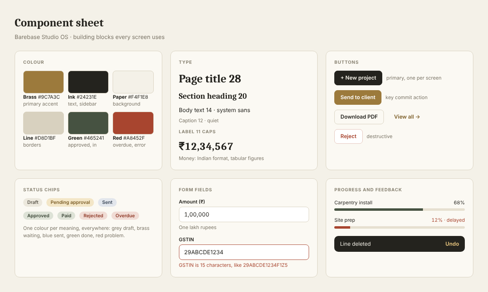

### Colour use

| Colour | Hex | Use for | Never use for |
| --- | --- | --- | --- |
| Brass | #9C7A3C | Key commit buttons (Send, Approve), active nav item, links, highlights | Body text, large backgrounds |
| Ink | #24231E | Text, sidebar, primary buttons | Disabled states |
| Paper | #F4F1E8 | Page background | Text |
| Card | #FBF9F3 | Cards, panels, tables |  |
| Line | #D8D1BF | Borders, dividers, empty bars | Text (fails contrast) |
| Green | #465241 | Approved, paid, on track, money in | Decoration |
| Red | #A8452F | Overdue, rejected, errors, money-out warnings | Anything that is not a problem |

Text on paper must reach 4.5:1 contrast; quiet text uses #7A7466, never the Line colour.

### Type

| Style | Font | Size / weight | Where |
| --- | --- | --- | --- |
| Page title | Cambria, Georgia | 28 / bold | One per page, top left |
| Section heading | Cambria, Georgia | 20 / bold | Card and section titles |
| Body | System sans (Segoe UI, -apple-system) | 14 / regular | Everything else |
| Label | System sans | 11 / bold caps, letter-spaced | Table headers, field groups |
| Caption | System sans | 12 / regular, quiet colour | Helper text, timestamps |
| Money | Body or Cambria for totals | Tabular figures | Every amount, so columns line up |

### Spacing and shape

- 8-point grid: spacing is 4, 8, 16, 24, 32 or 48 px.
- Corner radius: 8 px for buttons and inputs, 12 px for cards, full round for chips.
- Cards have a 1 px Line border and no shadow. Shadows only on menus, popovers and dialogs.
- Page content is at most 1200 px wide, with 32 px side padding on desktop and 16 px on phones.

### Core components to build first

Button, PageHeader, Tabs, StatCard, StatusChip, DataTable, SideSheet, Dialog, Toast, MoneyInput, EmptyState, ProgressBar, Avatar, FileDrop, PhotoCapture. Props and states for each are in the Component API table below.

### Tokens as code

Put these in one file (`styles/tokens.css`) and never write a raw hex value anywhere else.

```css
:root {
  /* colour */
  --bb-brass: #9C7A3C;      --bb-brass-dark: #7C5E28;  --bb-brass-tint: #F3E6C7;
  --bb-ink: #24231E;        --bb-ink-2: #3A372F;       /* sidebar active item */
  --bb-paper: #F4F1E8;      --bb-card: #FBF9F3;        --bb-white: #FFFFFF;
  --bb-line: #D8D1BF;       --bb-line-soft: #ECE6D6;
  --bb-text: #24231E;       --bb-text-quiet: #7A7466;  --bb-text-label: #8A8474;
  --bb-green: #465241;      --bb-green-tint: #DDE2D6;
  --bb-red: #A8452F;        --bb-red-tint: #F0DCD5;
  --bb-blue-text: #3B4757;  --bb-blue-tint: #E2E6EC;
  --bb-grey-text: #5E5A4F;  --bb-grey-tint: #ECE8DD;

  /* type */
  --bb-font-serif: Cambria, Georgia, serif;
  --bb-font-sans: system-ui, -apple-system, "Segoe UI", Calibri, Arial, sans-serif;
  --bb-text-xs: 11px;  --bb-text-sm: 12px;  --bb-text-md: 14px;
  --bb-text-lg: 20px;  --bb-text-xl: 28px;  --bb-text-num-xl: 30px;

  /* spacing (8-point) */
  --bb-space-1: 4px;  --bb-space-2: 8px;   --bb-space-3: 16px;
  --bb-space-4: 24px; --bb-space-5: 32px;  --bb-space-6: 48px;

  /* shape and depth */
  --bb-radius-sm: 8px;  --bb-radius-md: 12px;  --bb-radius-pill: 999px;
  --bb-shadow-pop: 0 8px 24px rgba(36, 35, 30, 0.12);  /* menus, dialogs only */
  --bb-focus: 0 0 0 2px var(--bb-paper), 0 0 0 4px var(--bb-brass);

  /* layout */
  --bb-sidebar: 240px;  --bb-sidebar-collapsed: 64px;
  --bb-topbar: 68px;    --bb-content-max: 1200px;  --bb-sheet: 520px;
}
```

If minERP uses Tailwind, map the same values into the theme instead:

```js
// tailwind.config.js (extend)
colors: {
  brass: { DEFAULT: '#9C7A3C', dark: '#7C5E28', tint: '#F3E6C7' },
  ink: { DEFAULT: '#24231E', 2: '#3A372F' },
  paper: '#F4F1E8', card: '#FBF9F3',
  line: { DEFAULT: '#D8D1BF', soft: '#ECE6D6' },
  quiet: '#7A7466', label: '#8A8474',
  ok: { DEFAULT: '#465241', tint: '#DDE2D6' },
  bad: { DEFAULT: '#A8452F', tint: '#F0DCD5' },
  info: { DEFAULT: '#3B4757', tint: '#E2E6EC' },
},
fontFamily: {
  serif: ['Cambria', 'Georgia', 'serif'],
  sans: ['system-ui', '-apple-system', 'Segoe UI', 'Calibri', 'Arial', 'sans-serif'],
},
borderRadius: { sm: '8px', md: '12px' },
```

### Status to chip: one map for the whole app

Every status in every module goes through this map. A new status is added here first, never styled inline.

```ts
// lib/status.ts
export type Tone = 'grey' | 'brass' | 'blue' | 'green' | 'red';

export const STATUS: Record<string, { label: string; tone: Tone }> = {
  draft:            { label: 'Draft',            tone: 'grey'  },
  pending_approval: { label: 'Pending approval', tone: 'brass' },
  on_hold:          { label: 'On hold',          tone: 'grey'  },
  sent:             { label: 'Sent',             tone: 'blue'  },
  due:              { label: 'Due',              tone: 'brass' },
  approved:         { label: 'Approved',         tone: 'green' },
  partly_approved:  { label: 'Partly approved',  tone: 'brass' },
  paid:             { label: 'Paid',             tone: 'green' },
  received:         { label: 'Received',         tone: 'green' },
  open:             { label: 'Open',             tone: 'red'   },
  fixed:            { label: 'Fixed',            tone: 'brass' },
  closed:           { label: 'Closed',           tone: 'green' },
  rejected:         { label: 'Rejected',         tone: 'red'   },
  overdue:          { label: 'Overdue',          tone: 'red'   },
  delayed:          { label: 'Delayed',          tone: 'red'   },
  on_track:         { label: 'On track',         tone: 'green' },
};
// tone -> background / text: grey (#ECE8DD / #5E5A4F), brass (#F3E6C7 / #7C5E28),
// blue (#E2E6EC / #3B4757), green (#DDE2D6 / #3A4535), red (#F0DCD5 / #8E3826)
```

### Component API

Build these as shared components before any screen. Every interactive component has the five states: default, hover, focus (brass ring, `--bb-focus`), disabled (50% opacity, no pointer) and loading where it applies.

| Component | Props | Behaviour and states |
| --- | --- | --- |
| `Button` | `variant: primary \| brass \| secondary \| ghost \| danger`, `size: md (36px) \| lg (44px)`, `icon?`, `loading?`, `href?` | Renders `<a>` when `href` is set, else `<button>`. Loading keeps the label and adds a spinner; it disables double submits |
| `PageHeader` | `title`, `breadcrumb?: {label, href}[]`, `actions?: ReactNode`, `meta?` | Title in serif 28; at most one primary action in `actions` |
| `Tabs` | `items: {label, href, count?}[]` | Route-based (each tab is a URL), never local state. Count shows as a red badge |
| `StatCard` | `label`, `value`, `sub?`, `href?`, `icon?`, `tone?` | Whole card is the link. Value uses tabular figures |
| `StatusChip` | `status` (a key of `STATUS`) | Label and tone come only from the map |
| `DataTable` | `columns`, `rows`, `rowHref?`, `sort?`, `pageSize = 50`, `columnPicker?`, `empty: EmptyState props`, `loading?` | Sticky header; money columns right-aligned; loading shows 6 skeleton rows; horizontal scroll inside its own box on phones with the first column pinned |
| `SideSheet` | `title`, `width = 520`, `footer?`, `open`, `onClose` | Opens from the right; Esc and backdrop close; traps focus; open state lives in the URL (`?sheet=<id>`) so it can be linked. Full screen on phones |
| `Dialog` | `title`, `body`, `confirmLabel`, `tone?: danger`, `onConfirm` | Only for irreversible or large actions. Confirm label names the action ("Send v3 to R. Iyengar") |
| `Toast` | `message`, `action?: {label, onClick}`, `duration` | 4 s default; 10 s when it carries Undo. Bottom centre on phone, bottom left on desktop |
| `MoneyInput` | `value` (string of rupees, 2 decimals), `onChange`, `confirmAbove = 100000`, `showWords = true` | Formats Indian commas as you type; shows amount in words below; above `confirmAbove` the form asks for a second confirmation |
| `EmptyState` | `title`, `body`, `action?` | Centred in the content area, one action button |
| `ProgressBar` | `value 0-100`, `tone?` | Green by default; red when the item is delayed. Always paired with the % as text |
| `Avatar` | `name`, `size = 28` | Initials on brass tint; same person always the same colour |
| `FileDrop` | `accept`, `maxMB = 50`, `multiple`, `folder` | Drag and drop plus click; shows each file's progress and lets you cancel |
| `PhotoCapture` | `max = 20`, `onAdd` | Opens the camera on phones; compresses to a 1600 px long edge at JPEG 0.8 before upload |

## 3. App shell and navigation

Every page sits in the same frame: a dark sidebar on the left, a slim top bar, then the page. On phones the sidebar becomes a five-item bottom bar, and the centre button opens the site actions people use most.

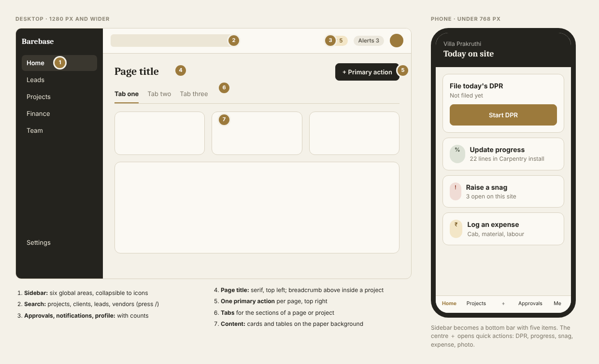

### Global navigation

| Sidebar item | Opens | Badge |
| --- | --- | --- |
| Home | Today's work for this person's role | None |
| Leads | Pipeline board | New untouched leads |
| Projects | All projects the person can see | None |
| Finance | Claims, entries, dashboards (org-wide) | Claims waiting for payout (Finance only) |
| Team | Users, roles, invites | None |
| Settings | Catalogue, vendors, templates, approval slabs | None |

### Inside a project

- The sidebar switches to the project: a back link (← All projects), the project name and client, then the project tabs: **Overview · Files · BOQ · Finance · Home budget · Milestones & DPR · Snags**, with Handover and History in the project menu.
- A breadcrumb sits above the page title: Projects › Villa Prakruthi › BOQ.
- Red count badges on tabs show things needing action (e.g. Milestones & DPR · 2 overdue).

### Top bar

Global search (press /), approvals tick with count, notifications bell with count, profile menu (Profile, Sign out). Search returns projects, clients, leads and vendors as you type, grouped by type.

### Rules

- The sidebar collapses to icons below 1280 px and on user choice; the choice is remembered.
- Items and tabs a person cannot use are hidden, not greyed out.
- The URL changes for every page and tab, so links can be shared and the back button always works.

### Route map

Every screen and tab has its own URL. Server checks permission on every route; the "Who" column is the default from the product spec's permissions matrix.

| Route | Screen | Layout | Who |
| --- | --- | --- | --- |
| `/login`, `/invite/[token]`, `/reset/[token]` | Sign in, accept invite, reset password | AuthShell | Public |
| `/` | Home | AppShell | All staff |
| `/leads`, `/leads/[id]` | Pipeline board, lead detail | AppShell | Admin, COO, pre-sales; design lead view |
| `/projects` | Projects list | AppShell | All staff (filtered to their projects) |
| `/projects/[id]` | Project Overview | ProjectShell | Project members, Admin, COO, Finance |
| `/projects/[id]/files` | Files | ProjectShell | Members |
| `/projects/[id]/boq` | BOQ builder (Build) | ProjectShell | Members who can edit BOQs; others read-only |
| `/projects/[id]/boq/client-view` | Preview of what the client sees | ProjectShell | Members |
| `/projects/[id]/boq/review` | Client Review | ProjectShell | Design lead, designers on the project |
| `/projects/[id]/boq/versions` | Versions and change orders | ProjectShell | Members |
| `/projects/[id]/finance` | Finance summary (cost-to-complete) | ProjectShell | Admin, COO, Finance, design lead |
| `/projects/[id]/finance/client`, `/vendor`, `/expenses` | Finance sub-tabs | ProjectShell | As above; designers see Expenses only |
| `/projects/[id]/milestones` | Milestones and progress | ProjectShell | Members |
| `/projects/[id]/milestones/dpr`, `/dpr/new`, `/dpr/[dprId]` | DPR list, new, detail | ProjectShell | Members, site supervisor |
| `/projects/[id]/snags`, `/snags/walk` | Snags list, snag walk (phone) | ProjectShell | Members, site supervisor |
| `/projects/[id]/handover` | Handover checklist, JMR | ProjectShell | Members |
| `/projects/[id]/history` | History log | ProjectShell | Members |
| `/approvals`, `/approvals/[id]` | Approvals inbox | AppShell | Anyone named in a slab |
| `/finance` | Org finance dashboard | AppShell | Admin, COO, Finance |
| `/finance/claims/new`, `/finance/claims` | Submit claim, my claims | AppShell | All staff |
| `/finance/reimbursements`, `/finance/transactions`, `/finance/gst` | Payouts, all entries, GST and TDS | AppShell | Admin, Finance |
| `/team` | Users, roles, invites | AppShell | Admin |
| `/settings/catalogue`, `/settings/vendors`, `/settings/approvals`, `/settings/templates`, `/settings/organisation` | Settings pages | AppShell | Admin (catalogue also design lead) |
| `/c/[token]` and `/c/[token]/estimate`, `/progress`, `/payments`, `/documents`, `/snags`, `/handover` | Client portal | ClientShell | The client contact holding the link |

**Renames from today's minERP:** `/org/items` → `/settings/catalogue`, `/org/users` → `/team`, `/org` → `/settings/organisation`, `/share/boq/[id]` → `/c/[token]`. Keep permanent redirects from the old URLs.

**Added 15 Oct (Home budget and vendor ledger)**

| Route | Screen | Layout | Who |
| --- | --- | --- | --- |
| `/projects/[id]/finance/vendors` | Vendors & bills (replaces `/finance/vendor`) | ProjectShell | Admin, COO, Finance; design lead per decision 17 |
| `/projects/[id]/budget` | Home budget: plan vs actual | ProjectShell | Members, Admin, COO, Finance |
| `/projects/[id]/budget/purchases` | Home budget: client purchases and timeline | ProjectShell | Members, Admin, COO |
| `/c/[token]/budget` | Client portal Budget tab | ClientShell | Client contact |

| Route | Screen | Layout | Who |
| --- | --- | --- | --- |
| `/projects/[id]/finance/proforma/new` | Proforma invoice creator | ProjectShell | Admin, COO, Finance, design lead |
| `/projects/[id]/finance/po/new` | Purchase order creator | ProjectShell | Admin, COO, design lead |
| `/finance/sent` (and `/projects/[id]/finance/sent`) | Sent & due tracker | AppShell / ProjectShell | Admin, COO, Finance; others see documents they sent |

### Layout tree

```text
app/
  (auth)/                      AuthShell: centred card on paper, no sidebar
    login/  invite/[token]/  reset/[token]/
  (app)/layout.tsx             AppShell: Sidebar + TopBar; redirects to /login without a session
    page.tsx                   Home
    leads/  projects/page.tsx  approvals/  finance/  team/  settings/
    projects/[id]/layout.tsx   ProjectShell: project sidebar, breadcrumb, stage bar;
                               loads the project once and checks membership
      page.tsx                 Overview
      files/  boq/  finance/  milestones/  snags/  handover/  history/
  c/[token]/layout.tsx         ClientShell: letterhead header, tabs; token + email code, no staff session
```

**Sidebar data:** the AppShell loads the badge counts (untouched leads, approvals waiting, unread notifications) in one request and refreshes them every 60 seconds and after any approval action.

## 4. Key user flows

A job moves through nine steps, and every step happens in the app, from the first WhatsApp lead to the client signing the handover. Each step names who acts and which screen they use.

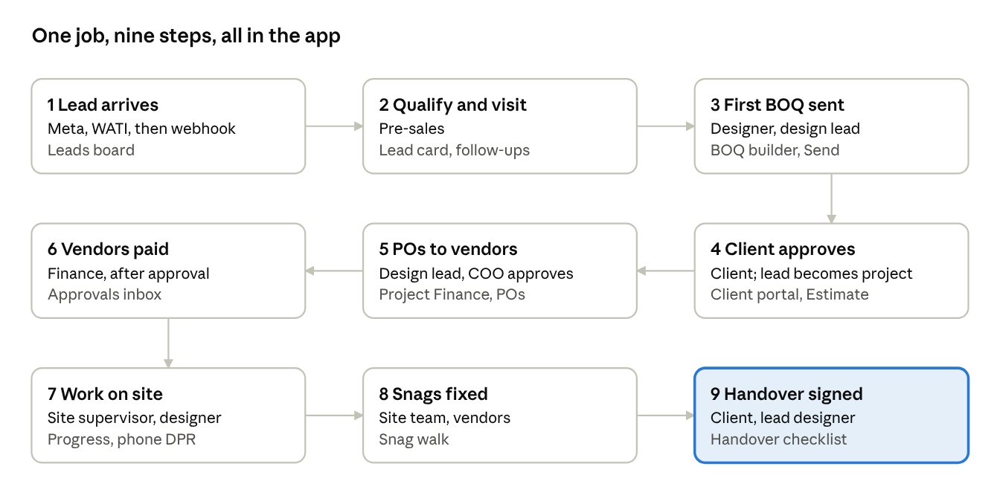

### Build, send and review a BOQ

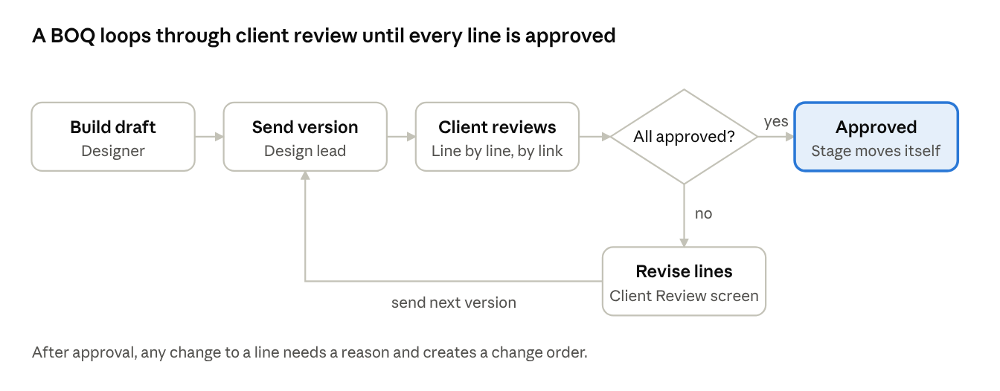

The client approves, asks for a change or rejects each line. The designer answers on the Client Review screen, and the next version shows the client only what changed.

### Approve and pay a vendor

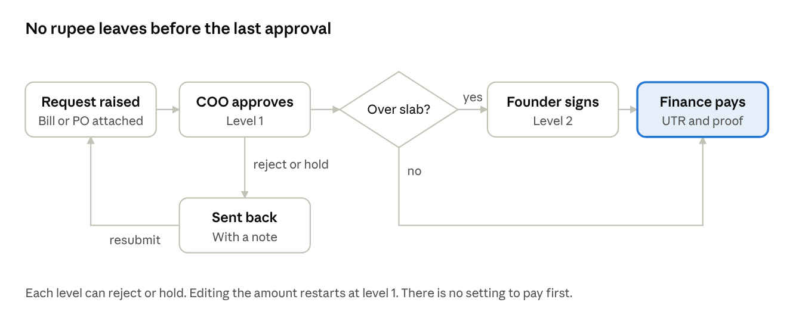

The slab amount is set in Settings (example: above ₹2,00,000 needs the Founder). Finance only sees a Record payment button once the last level has approved.

### File a DPR on site (phone)

1. Open the project from Home, tap the ＋ button, choose Daily report.
2. Today's progress updates are already listed; add any missing ones with the slider.
3. Tap the camera and add photos; type or dictate one line on the work done.
4. Check manpower (prefilled from yesterday) and add any blocker.
5. Tap Submit report. The client sees it in their portal; a blocker notifies the lead designer.

### From snag to handover

1. Start a snag walk; for each room, photograph the issue, name it, assign it and set a fix-by date.
2. The assignee fixes it and adds an "after" photo; the lead designer verifies and closes it.
3. When all snags are closed, the handover checklist unlocks; remaining items are ticked with files or photos.
4. The client signs off in their portal; the project moves to Handover by itself.

### Status machines

Each flow above is a status machine. Implement each one as a single server function per object (e.g. `transitionPaymentRequest(id, action, note)`) that checks the allowed move, the permission and the side effects in one place. The UI only shows buttons for moves the server would allow; any other move returns an error.

**BOQ version**

| From | Action | To | Who | Side effects |
| --- | --- | --- | --- | --- |
| draft | Send to client | sent | Design lead, Admin, COO | Freezes a snapshot; earlier sent version becomes superseded; project stage → Quotation (first time); client notified |
| sent | Client submits review, all lines approved | approved | Client | Project stage → Approved; can be made main version; team notified |
| sent | Client submits review, some lines not approved | partly\_approved | Client | Team notified; Client Review screen lists open lines |
| sent, partly\_approved | Edit | new draft (number + 1) | Designer, design lead | Copies lines from this version |
| approved | Edit a line | new draft + change order | Design lead, Admin, COO | Reason required; change order records old → new and ₹ impact |

**Payment request (vendor or client side)**

| From | Action | To | Who | Side effects |
| --- | --- | --- | --- | --- |
| draft | Submit | pending\_approval (level 1) | Requester | Approvers at level 1 notified |
| pending\_approval (level n) | Approve, more levels left | pending\_approval (level n + 1) | Named approver, not the requester | Next level notified |
| pending\_approval (last level) | Approve | approved | Named approver | Finance notified; Record payment button appears |
| pending\_approval | Hold (note) | on\_hold | Named approver | Requester notified |
| on\_hold | Resume | pending\_approval (same level) | Same approver |  |
| pending\_approval, on\_hold | Reject (note) | rejected | Named approver | Requester notified; can edit and resubmit, which restarts at level 1 |
| any pending | Amount edited | pending\_approval (level 1) | Requester | All earlier approvals cleared |
| approved | Record payment | paid (or partly paid) | Finance, Admin | Ledger entry written; budget figures update |

**Snag**

| From | Action | To | Who | Side effects |
| --- | --- | --- | --- | --- |
| (new) | Raise | open | Members, site, client | Assignee notified |
| open | Mark fixed (after photo required) | fixed | Assignee | Lead designer notified |
| fixed | Verify | closed | Design lead, Admin, COO | Handover checklist recounts |
| fixed | Not fixed (note) | open | Design lead | Assignee notified |
| open | Won't fix (reason) | closed (won't fix) | Design lead approval | Logged with reason |

**Project stage** moves only through these side effects plus the manual On hold, Lost and Reopened actions (product spec, section 6). There is no free stage dropdown.

## 5. Screens

Fifteen core screens, each with a reference image and the behaviour behind it. Home, Projects, Project Overview and BOQ come from the approved design canvas; Finance, Approvals and the phone screens are new mock-ups in the same style. Match layout and hierarchy closely; exact pixel values can follow the component sheet.

### 5.1 Home

See the image in section 1.

- **Greeting and date**, then the two most common actions (New lead, New project) top right.
- **Four stat cards:** active projects, open leads, approvals waiting, open snags. Each card is a link to its list, filtered.
- **Recent projects** with stage, progress bar and a status chip (On track, Awaiting client, Delayed).
- **Waiting on you** (right): the person's approvals and sign-offs, newest first, each one click from the action.
- Cards change by role (product spec, section 16). Pre-sales sees leads first; site staff see today's site actions.

**Build notes · Home**

|  |  |
| --- | --- |
| Route | `/` |
| Components | PageHeader (greeting as title, date as meta, actions: New lead, New project) · 4 × StatCard · project list rows with ProgressBar and StatusChip · "Waiting on you" list · activity feed |
| Data | Counts: active projects, open leads (+ needing follow-up), approvals waiting for me, open snags (+ site count) · my 4 most recently updated projects with stage, progress %, status · my approvals (top 4) · last 5 activity events I can see · role decides which cards load |
| States | Each card loads on its own with a skeleton, so one slow query never blocks the page · a new user with no projects sees an EmptyState in the projects card |
| Permissions | Finance snapshot and team workload only for Admin, COO, Finance |
| Done when | First paint under 1.5 s with 50 projects in the database; every card and row is a link; layout matches the reference at 1440 px and stacks to one column at 375 px |

### 5.2 Projects list

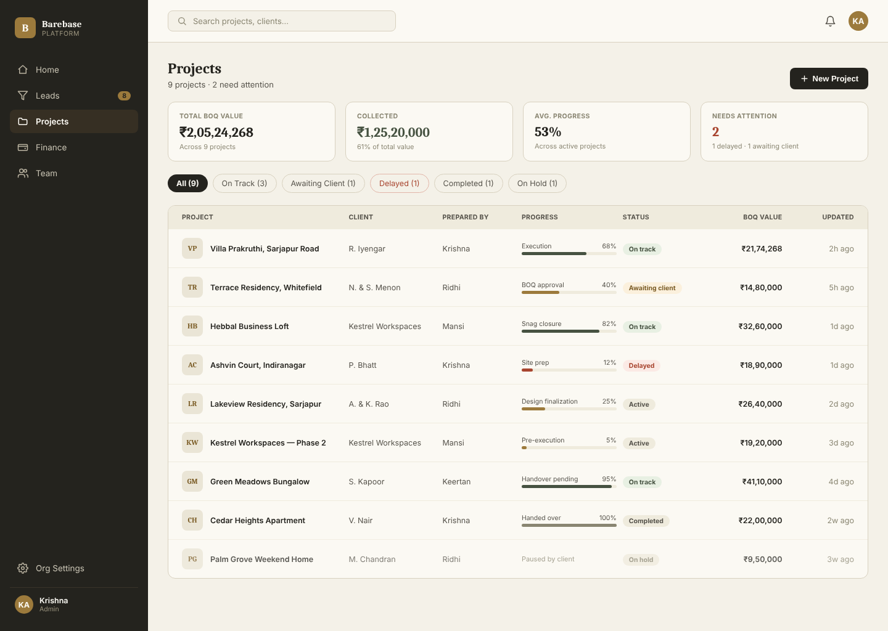

- Status tabs with counts across the top; search and filters (lead designer, city, stage) on one row.
- Each row: project and client, stage chip, progress, contract value, received %, next milestone, last updated.
- Table and card views; the choice is remembered. Clicking anywhere on a row opens Project Overview.
- Empty state: "No projects yet · Create your first project" with the primary button.

**Build notes · Projects list**

|  |  |
| --- | --- |
| Route | `/projects?stage=&lead=&city=&q=&view=table\|cards` (filters live in the URL) |
| Components | PageHeader (New project) · Tabs by stage with counts · search + filter chips · DataTable or card grid · SideSheet for New project |
| Data | Per project: code, name, client, stage, lead designer, contract value, received %, progress %, next milestone + date, updated at · counts per stage |
| States | Skeleton rows · EmptyState for no projects · "No projects match" with Clear filters when filters return nothing |
| Permissions | Query filters by membership for roles without "see all projects"; New project button only for roles that may create |
| Done when | Filters and view survive a page refresh and a shared link; 200 projects paginate at 50 without lag |

### 5.3 Project Overview

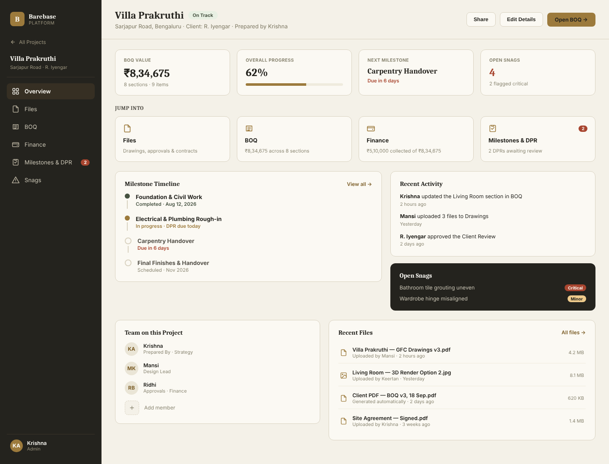

- Project-scoped sidebar with the six tabs; stage bar across the top shows where the job is.
- Money, progress and BOQ cards answer "how is this job doing?" without opening a tab.
- **Needs attention** list: overdue client payment, open snags, unanswered client comments, pending approvals. Each item links to the exact place.
- Recent activity feed at the bottom.

**Build notes · Project Overview**

|  |  |
| --- | --- |
| Route | `/projects/[id]` |
| Components | ProjectShell (project sidebar, breadcrumb, stage bar) · money, progress and BOQ cards · "Needs attention" list · activity feed |
| Data | Project header fields and stage history · money: contract value, received, outstanding, paid out, margin (cost viewers) · progress %, next milestone, overdue tasks · main BOQ version, status, review count ("14 of 22 approved") · attention items (max 5, most urgent first) · last 10 history events |
| States | Stage bar shows the current stage filled, past stages ticked, side states (On hold, Lost) as a chip beside it · new project with no BOQ shows "Start the BOQ" in the BOQ card |
| Permissions | Margin and cost hidden server-side for non-cost viewers; non-members get a 404 |
| Done when | Every number matches the Finance and BOQ tabs exactly; attention items link to the exact record |

### 5.4 BOQ builder

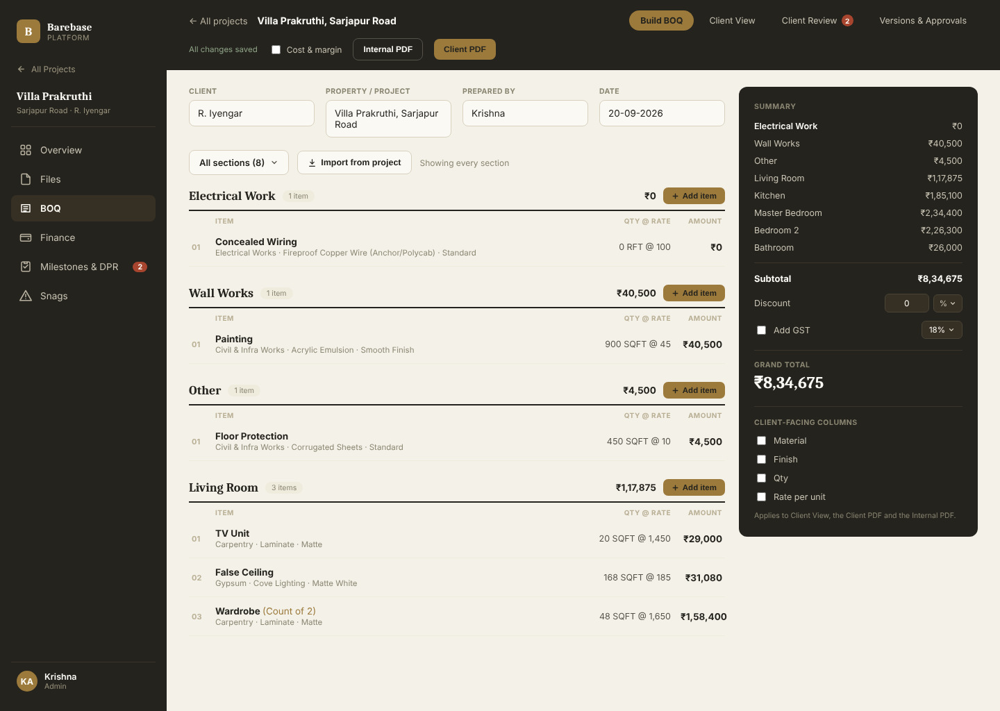

- Dark top bar with the BOQ sub-pages: **Build BOQ · Client View · Client Review · Versions & Approvals**, a "saved" indicator, the Cost & margin toggle (cost viewers only), and Internal and Client PDF buttons.
- Project details row (client, property, prepared by, date) at the top.
- Rooms as sections, each with item count, subtotal and "+ Add item". Lines show name, then category · material · finish in quiet text, then quantity @ rate and amount on the right.
- Dark **summary panel** on the right stays visible while scrolling: totals per room, subtotal, discount, GST, grand total, client-facing column toggles.
- Clicking a line edits it in place. Tab and Enter move between cells; Enter on the last cell adds a new line.
- Behaviour to keep from BOQ Studio: count on a line ("Wardrobe, count of 2"), quantity override marker, import from another project.

**Build notes · BOQ builder**

|  |  |
| --- | --- |
| Route | `/projects/[id]/boq` (Build) · `/boq/client-view` · `/boq/review` · `/boq/versions` |
| Components | Dark sub-header with route Tabs, SaveIndicator, cost toggle, PDF buttons · details row (inputs) · room sections with inline line editor · item picker (combobox) · sticky SummaryPanel · Dialog for Send |
| Data | BOQ settings (discount, GST, client columns, terms) · rooms → lines with all line fields · catalogue search endpoint (`?q=&category=`, returns name, material, finish, unit, selling rate, cost for cost viewers) · version list · lock holder |
| Editing model | Optimistic: change shows at once, saves in the background (debounce 600 ms per line); on failure the line turns red with Retry. Totals are recalculated on the client with the same shared calculation module the server uses, and the server value replaces it on save |
| States | "Saving…" / "All changes saved" / "Couldn't save, retrying" indicator · read-only banner when the version is Sent or Approved ("Sent on 20 Sep. Edit to create v4") · lock banner when someone else is editing · empty room shows "+ Add item" only |
| Keyboard | Tab / Shift+Tab across cells · Enter on last cell adds a line · Ctrl/Cmd+K opens the item picker · Delete on a selected line removes it with Undo |
| Permissions | Cost toggle, cost column and Internal PDF only for cost viewers; edit controls hidden for read-only roles |
| Done when | A 60-line, 8-room BOQ edits without lag on a mid-range laptop; totals match BOQ Studio to the paisa; refresh mid-edit loses nothing that showed "saved" |

### 5.5 Project Finance

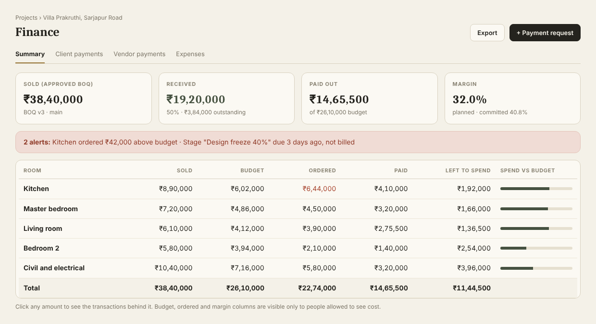

- Four tabs: **Summary · Client payments · Vendor payments · Expenses**. Summary is the default.
- Four headline cards: sold, received, paid out, margin. Margin cards and budget columns appear only for cost viewers.
- A red alert strip appears only when something is wrong (over budget, stage due but not billed).
- The room table is the cost-to-complete view. Over-budget figures turn red; every figure opens its transactions.

**Build notes · Project Finance**

|  |  |
| --- | --- |
| Route | `/projects/[id]/finance` (Summary) · `/finance/client` · `/finance/vendor` · `/finance/expenses` |
| Components | PageHeader (Export, + Payment request) · route Tabs · 4 × StatCard · alert strip (only when alerts exist) · DataTable with footer total row · SideSheet listing the transactions behind a clicked figure |
| Data | Per room: sold, budget, ordered, paid, left to spend, billed, received · project totals · margin planned / committed / realised · alerts list. All figures come from one server query over the ledger, POs and the main BOQ version, so cards and table can never disagree |
| Money handling | Amounts travel as strings with 2 decimals (from `Decimal(14,2)`), never as JS floats; format only at display with `formatINR` (section 7) |
| States | No main BOQ version yet: EmptyState "Approve a BOQ to see the budget" · no payments yet: zeros, not dashes |
| Permissions | Budget, ordered, margin and left-to-spend columns removed server-side for non-cost viewers; designers land on Expenses |
| Done when | Table totals equal the sum of rows and equal the cards; clicking any figure lists exactly the entries that sum to it |

### 5.6 Approvals inbox

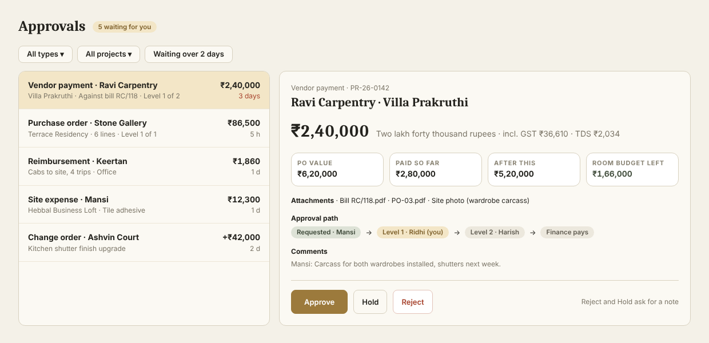

- Two panes: the list on the left, the selected item on the right. On phones the detail opens full screen.
- Each list row: type and payee, project and reference, level, amount, and how long it has waited (red after 2 days).
- Detail shows the amount in figures **and words**, the money context (PO value, paid so far, after this, budget left), attachments, the approval path with the current step highlighted, and comments.
- Approve is one click. Hold and Reject open a short note box. After acting, the next item opens automatically.

**Build notes · Approvals inbox**

|  |  |
| --- | --- |
| Route | `/approvals?type=&project=&stale=1` · `/approvals/[id]` selects an item (phone: full-screen page) |
| Components | PageHeader with count chip · filter buttons · list (left, 440 px) · detail panel (right) with amount, words, context StatCards, attachments, approval path chips, comment thread, action bar |
| Data | Items where I am named at the current level: type, payee, project, reference, level n of m, amount, waiting since · for the selected item: money context (PO value, paid so far, after this, budget left), attachments, path, history, comments |
| Actions | Approve (one click) · Hold and Reject open a required note · all three call the status machine (section 4); on success the next item opens and the sidebar count updates |
| States | Empty: "Nothing waiting for you" · items older than 48 h show the wait in red · if someone else acted first: "Already approved by Ridhi" and the item leaves the list |
| Permissions | The requester never sees action buttons on their own request; others see the item read-only |
| Done when | Approving with the keyboard alone works (arrow keys move, A approves, H holds, R rejects); double-clicking Approve records one approval |

### 5.7 Phone screens: DPR, snag walk, client portal

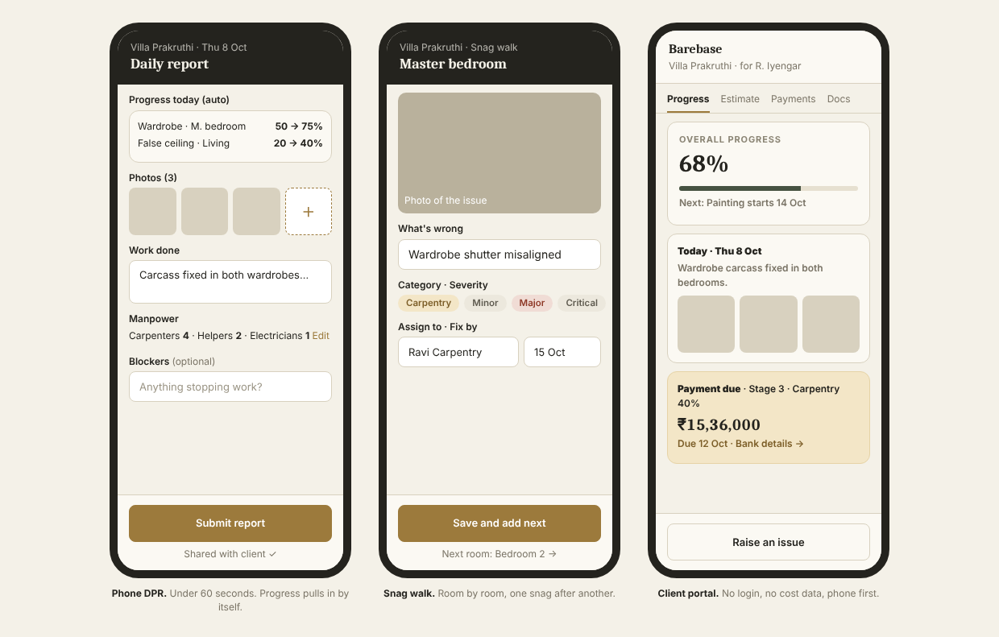

- **DPR:** today's progress updates pull in by themselves; the person adds photos, a line of text, manpower (prefilled) and blockers. One big Submit button stays at the bottom.
- **Snag walk:** camera first, then a short form; "Save and add next" keeps the person in the same room until they move on.
- **Client portal:** the client's view of their job: progress with photos, estimate, payments due, documents. No cost data, no login, built for a phone.

**Build notes · phone screens**

|  | DPR | Snag walk | Client portal |
| --- | --- | --- | --- |
| Route | `/projects/[id]/milestones/dpr/new` | `/projects/[id]/snags/walk?room=` | `/c/[token]/progress` (default tab) |
| Components | Progress list (auto) · PhotoCapture · textarea · manpower steppers · sticky Submit bar | PhotoCapture (first) · title input · category and severity chips · assignee combobox · date · sticky Save-and-next bar | ClientShell header · tabs · progress card · DPR feed · payment-due card · Raise an issue button |
| Data | Today's progress updates for this project · yesterday's manpower | Rooms from the main BOQ · assignable people and vendors | Shared DPRs (no manpower or blockers), milestones, payment stages, shared files |
| Offline | Draft saved on the device as you type; queued with "Waiting to send" if offline; sends when back online | Same as DPR | Read-only; shows last loaded data with "Offline" chip |
| Done when | Filed in under 60 s with 3 photos on 4G; one DPR per project per day (second opens the first to edit) | 10 snags in one room in under 3 minutes | Any client API response checked by an automated test for absence of cost, margin, notes and vendor rates |

### 5.8 Vendors & bills (Project Finance)

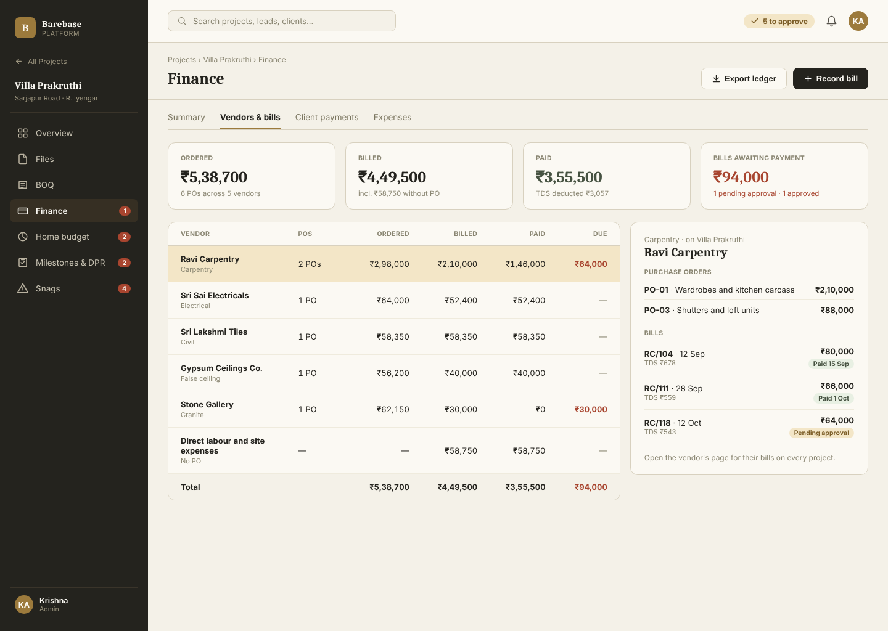

- A Finance sub-tab: one row per vendor on this project, plus a row for direct labour and site expenses without a PO, so totals match the Summary tab.
- Clicking a vendor fills the right panel with its POs and bills; each bill shows number, date, amount, TDS and a status chip.
- Due amounts in red are bills awaiting approval or payment; each links to its approval.

**Build notes · Vendors & bills**

|  |  |
| --- | --- |
| Route | `/projects/[id]/finance/vendors?vendor=` (selected vendor in the URL) |
| Components | 4 × StatCard · DataTable with total row · detail panel (SideSheet on phones) · StatusChip |
| Data | Per vendor on this project: trade, PO count, ordered, billed, paid, due, TDS; POs (ref, description, amount); bills (ref, date, amount, TDS, status, linked approval) |
| States | No vendors yet: EmptyState "Raise a PO from the BOQ" |
| Permissions | Server-side: hidden from roles without vendor-ledger access; bank details never shown here |
| Done when | Column totals equal the Summary tab's ordered and paid; every bill links to its approval or payment record |

### 5.9 Home budget: plan vs actual

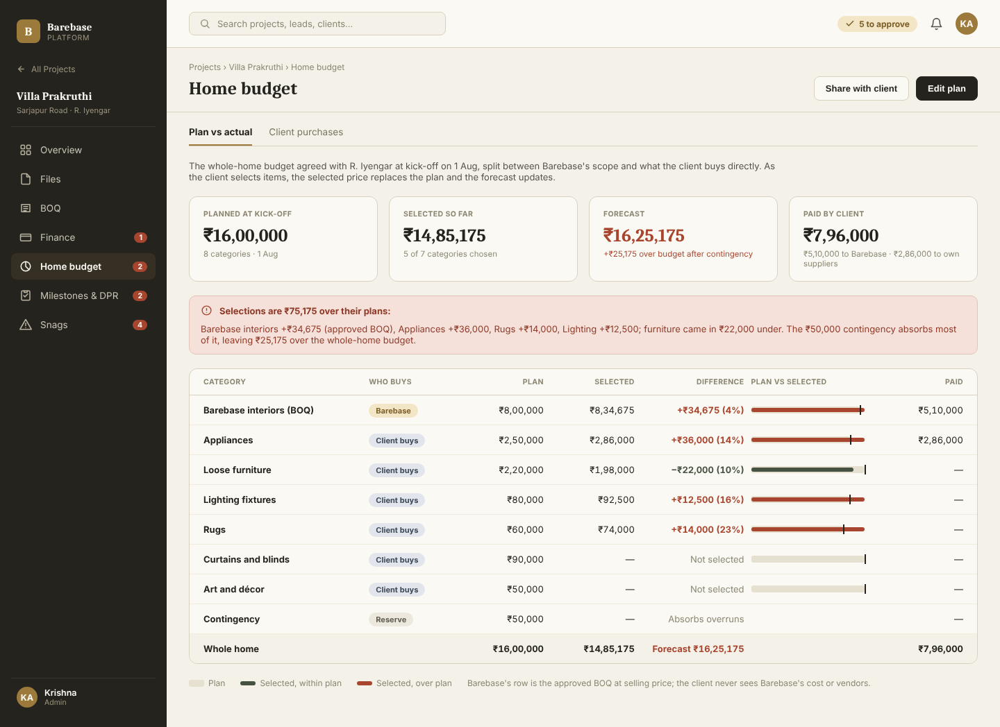

- A new project tab between Finance and Milestones & DPR, with two sub-tabs: **Plan vs actual** and **Client purchases**.
- Each category row: who buys it (Barebase, Client, Reserve), plan, selected, difference in ₹ and %, a bar, and paid by client.
- The bar is scaled per row so small categories are as readable as large ones: grey band = plan, line = selected (green within plan, red over), black tick = plan mark.
- The Contingency row has no bar; it says "Absorbs overruns". Forecast and the over-budget figure follow product spec section 11A.

**Build notes · Home budget**

|  |  |
| --- | --- |
| Route | `/projects/[id]/budget` |
| Components | Route Tabs · 4 × StatCard · alert strip · DataTable with footer · PlanBar (new: plan, selected, scale) · SideSheet for Edit plan |
| Data | Current BudgetPlan with categories; per category: plan, selected (sum of selected client purchases, or approved BOQ total for the Barebase row), paid by client; earlier baselines for the history menu |
| States | No plan yet: EmptyState "Set the home budget" with a form prefilled from the estimate and default categories |
| Done when | Forecast, over-budget and per-row differences match the formulas in product spec 11A for the seed project |

### 5.10 Home budget: client purchases

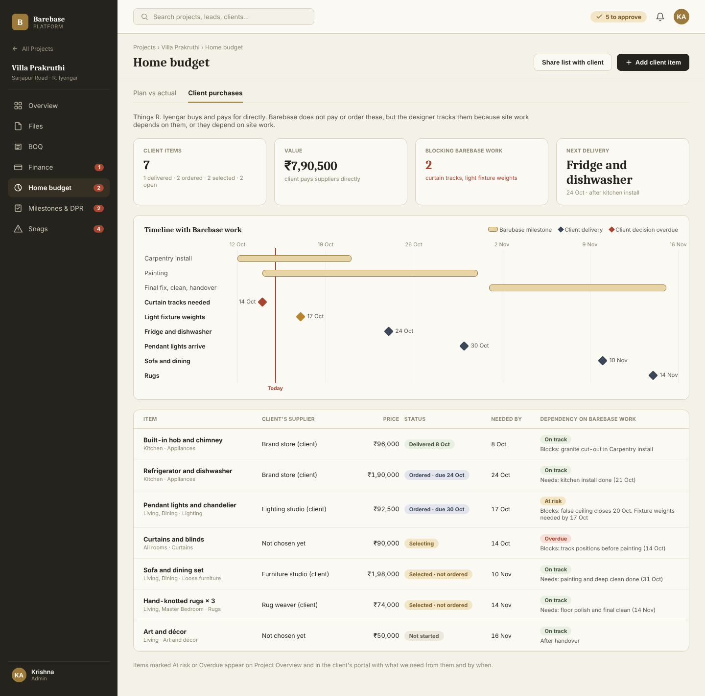

- **Timeline** on top: Barebase milestones as bars, client deliveries as dark diamonds, overdue or at-risk client decisions in red or amber, and a Today line. Labels sit away from the Today line.
- **Table** below: item with room and category, client's supplier, price, status chip, needed-by date, and the dependency with its On track / At risk / Overdue chip and plain sentence ("Blocks: false ceiling closes 20 Oct").
- Add and edit items in a SideSheet; choosing a milestone and Needs or Blocks fills the dependency sentence automatically.

**Build notes · Client purchases**

|  |  |
| --- | --- |
| Route | `/projects/[id]/budget/purchases` |
| Components | Route Tabs · StatCards · Timeline (new: milestone bars, markers, today line, weeks axis) · DataTable · SideSheet form |
| Data | Client purchases with category, rooms, supplier text, price, status, expected delivery, needed-by, milestone and dependency type; milestones with planned dates |
| States | Empty: "Nothing the client is buying yet · Add client item" |
| Done when | An item's dependency chip changes to Overdue the day after its needed-by date passes without an order; Overdue and At risk items appear on Project Overview |

### 5.11 Client portal: Budget tab

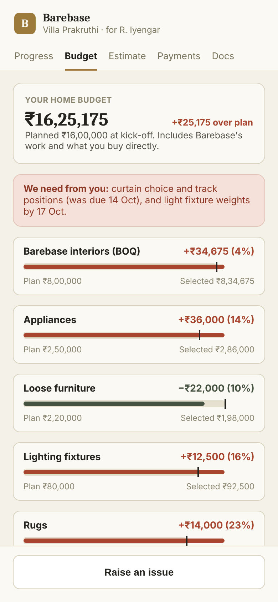

- Shows the forecast against the kick-off plan, a **We need from you** box listing the client's overdue and at-risk decisions with dates, and one card per category with its plan bar.
- The Barebase row shows the approved estimate at selling price only. No cost, margin, vendor or bill data reaches this page.

### 5.12 Proforma invoice creator

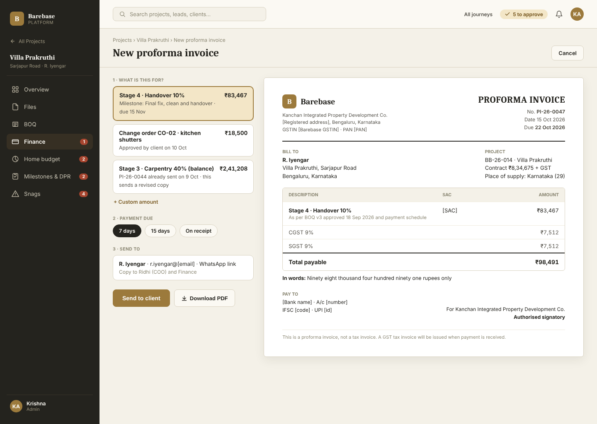

- Two columns: the choices on the left, a live A4-style preview on the right that updates as each choice changes. On phones the preview moves below the choices.
- Stage options are cards showing name, note and amount; the selected card has a brass border.
- After **Send to client**, a green confirmation names the proforma number and links to Sent & due.

**Build notes · Proforma creator**

|  |  |
| --- | --- |
| Route | `/projects/[id]/finance/proforma/new?stage=` |
| Components | Option cards · chip group · recipient card · DocumentPreview (new: letterhead, parties, line table, tax rows, words, bank, signatory) · PDF from the same component |
| Data | Open payment stages and approved change orders with amounts · client contacts and state · org letterhead, GSTIN, PAN, bank · next proforma number |
| Done when | Preview and PDF show identical figures; IGST replaces CGST and SGST for an out-of-state client; sending creates a SentDocument with the right due date |

### 5.13 Purchase order creator

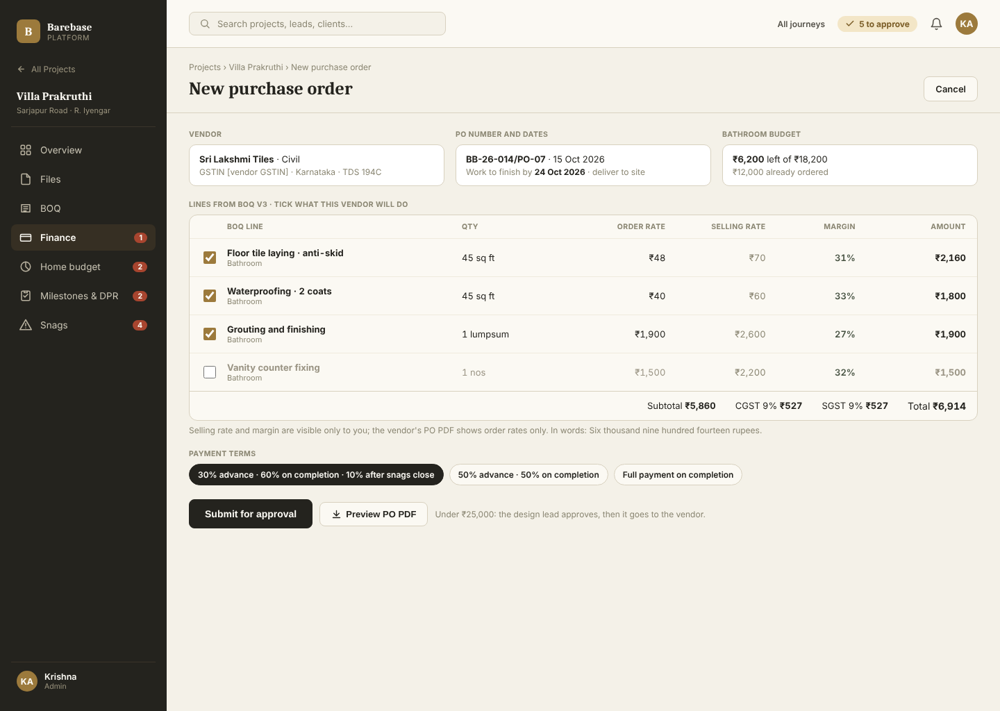

- Three cards on top: vendor, PO number and dates, room budget left.
- BOQ lines as rows with a real checkbox each; unticked rows grey out and leave the total. Selling rate and margin columns render only for cost viewers.
- A red warning appears only when the PO exceeds the room's budget left, and then a reason field becomes required.

**Build notes · PO creator**

|  |  |
| --- | --- |
| Route | `/projects/[id]/finance/po/new?vendor=&room=` |
| Components | Summary cards · selectable line table · totals bar · alert strip · terms chips · approver hint from the slab rules |
| Data | Vendor (GSTIN, state, TDS section) · main-version BOQ lines with quantities already ordered · room budget and ordered totals · payment terms templates · next PO number |
| Done when | Totals use the shared calc module; the vendor PDF omits selling rate and margin; submitting creates an approval request at the right level |

### 5.14 Sent & due tracker

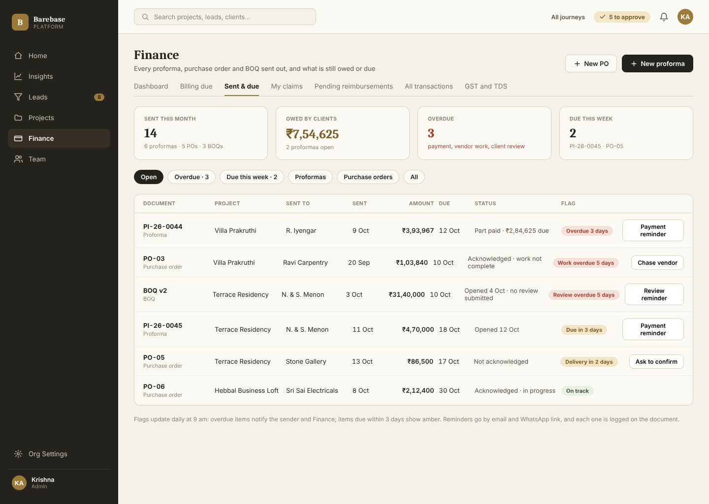

- A Finance tab, company-wide, with the same view filtered on each project's Finance tab.
- Each row: document and type, project, recipient, sent date, amount, due date, live status, flag chip (red Overdue, amber Due soon, green On track, grey Closed), and one follow-up button. After a reminder the button becomes "Sent today ✓".
- Default filter is Open, so closed items stay out of the way.

**Build notes · Sent & due**

|  |  |
| --- | --- |
| Route | `/finance/sent?filter=open\|overdue\|soon\|pi\|po\|all` |
| Components | StatCards · filter chips (in the URL) · DataTable with flag chips and row actions |
| Data | SentDocument rows joined to their documents, amounts paid, open and acknowledge times, reminder history |
| Jobs | Daily 9 am job recalculates flags and sends overdue notifications to sender and Finance |
| Done when | Flags match the due rules in product spec 11B for every document type; a reminder is logged once even if the button is double-clicked |

### 5.15 Billing due (proformas drafted from milestones)

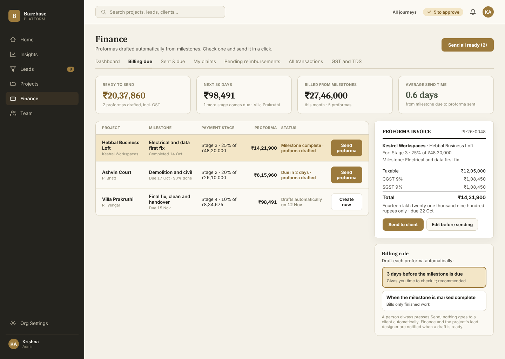

- A Finance tab, company-wide, between Dashboard and Sent & due. Each project's Finance tab shows the same queue filtered to that project.
- One row per payment stage that is drafted or coming up: project and client, milestone with its due date or completion date, stage ("Stage 3 · 25% of ₹48,20,000"), amount incl. GST, status, and **Send proforma**. Stages not yet due show "Drafts automatically on 12 Nov" and no button.
- Clicking a row opens the proforma preview on the right: taxable, CGST and SGST (or IGST), total, amount in words, due date. Buttons: **Send to client** (primary) and **Edit before sending** (opens the proforma creator, pre-filled).
- **Send all ready (n)** at the top right sends every drafted row after one dialog: "Send 2 proformas totalling ₹20,37,860?"
- After sending, the row shows "Sent ✓ · tracked in Sent & due" and leaves the queue the next day.
- The Billing rule card (Admin only) picks *3 days before the milestone is due* (default) or *when the milestone is marked complete*, with the line "A person always presses Send; nothing goes to a client automatically."
- The project's Milestones screen gets a **Client billing** column (Stage 4 · drafts 12 Nov, Stage 3 · PI-26-0044 overdue, Stage 1 · paid) linking here or to Sent & due.

**Build notes · Billing due**

|  |  |
| --- | --- |
| Route | `/finance/billing` (company) and `/projects/[id]/finance/billing` (project) |
| Components | StatCards · DataTable with row action · ProformaPreview (shared with the proforma creator) · rule RadioCards · confirm Dialog |
| Data | PaymentStage with milestoneId, billingState and draftedProformaId; the drafted Proforma; Milestone due date and status |
| Jobs | Nightly 6 am job drafts proformas per the org's billingTrigger; recalculates unsent drafts when a milestone date or contract value changes; notifies Finance and the lead designer |
| Done when | A milestone due 21 Oct with the default rule shows a correct draft on 18 Oct; Send moves it to Sent & due in one click; no proforma is emailed without a person pressing Send; Send all asks once and sends each draft exactly once |

## 6. UX patterns

The same situation always behaves the same way, on every screen. Build each pattern once as a shared component and reuse it.

| Situation | Pattern | Example |
| --- | --- | --- |
| Creating something | Short form in a side sheet from the right; only required fields shown, the rest under "More details" | New project: name, client, lead designer |
| Editing a record | Edit in place where possible (tables, BOQ lines); otherwise the same side sheet | Change a line's rate by clicking it |
| Saving | Autosave with a "Saved" indicator in drafts; explicit Save only for money entries and settings | BOQ builder shows "All changes saved" |
| Deleting small things | Delete at once, then a 10-second toast with Undo | Removing a BOQ line |
| Irreversible or big actions | Dialog naming the exact consequence, with the action as the button label | "Send v3 to R. Iyengar" not "OK" |
| Money input | Indian commas as you type, amount in words below, second confirmation above ₹1,00,000 | "₹10,00,000 · ten lakh rupees" |
| Field errors | Shown under the field as you leave it, red border, says how to fix | "Phone should be 10 digits" |
| Page errors | Banner at the top with what happened and a retry; no technical codes | "Couldn't load payments. Try again" |
| Loading | Skeleton blocks shaped like the content; never a full-page spinner; nothing waits longer than 1.5 s | Table rows as grey bars |
| Empty lists | What this list is for, plus the first action | "No snags yet · Raise a snag" |
| Long lists | Search and filters on one row above; 50 rows a page; filters shown as removable chips | Catalogue of 253 items |
| Tables | Sticky header, status and amount always visible, column picker for extras, numbers right-aligned | Finance summary |
| Detail views | Side sheet over the list, so the list keeps its place | Opening an approval or a snag |
| Status | One chip vocabulary and colour per meaning (section 2) | Pending approval in brass everywhere |
| Notifications | Bell list grouped by item; toast only for things that just happened to you | "Ridhi approved your claim" |
| Conflicts | If someone else is editing, show who and lock the edit, never silently overwrite | "Mansi is editing this BOQ" |
| Permissions | Hide what someone cannot do; if they reach it by link, show "You don't have access" with who to ask | Designer opening Finance |

### Keyboard

/ opens search · N creates the main item on the page · Esc closes a sheet or dialog · Tab, Enter and arrow keys move through BOQ cells · Ctrl/Cmd + S saves where saving is explicit.

### How to implement the patterns

- **Mutations:** use server actions (or route handlers) that return `{ ok: true, data }` or `{ ok: false, error: { field?, message } }`. Field errors attach to the field; others show as a page banner or toast. Never show a raw exception.
- **Optimistic updates** only for low-risk edits (BOQ lines, task status, progress sliders). Money entries, approvals and sends wait for the server and show the button's loading state.
- **Undo:** soft-delete immediately (`deletedAt`), show the toast with Undo for 10 s; Undo clears `deletedAt`. A nightly job purges nothing that touches money or BOQ versions.
- **Double submits:** every create and every approval carries an idempotency key from the form, so a double click or a retried request records once.
- **Side sheets in the URL:** `?sheet=new-project` or `?sheet=snag-SNG-007`; closing removes the param. Back closes the sheet before leaving the page.
- **Editing locks:** a lock row (`lockedById`, `lockedAt`) renewed every 30 s while the editor is open; expires after 10 minutes idle. Others see the banner and read-only view.
- **Loading:** stream each page section with its own suspense boundary and skeleton; avoid one big loading state.
- **Notifications:** created on the server inside the same transaction as the event that causes them; the bell polls every 60 s (no websockets needed in v1).
- **Permissions in UI:** components receive a `can` object from the server (e.g. `can.editBoq`, `can.seeCost`) and hide controls from it; the server checks again on every action.

## 7. Mobile, accessibility and words

### Mobile

- Every page works at 375 px wide with no sideways scrolling of the page. Wide tables scroll inside their own box, with the first column pinned.
- Site screens are designed phone-first: DPR, progress update, snag, expense, photo upload, approvals.
- Touch targets at least 44 × 44 px. The main action sits at the bottom of the screen, within thumb reach.
- Camera opens directly from photo fields. Photos are compressed on the phone before upload (long edge 1600 px) so they send on 4G.
- If the connection drops while filing a DPR or snag, the draft is kept on the phone and sent when the connection returns, with a "Waiting to send" chip.
- Breakpoints: phone under 768 px, tablet 768 to 1279 px (sidebar collapsed to icons), desktop 1280 px and up.

### Accessibility

- Text contrast at least 4.5:1 (3:1 for text 24 px and larger). Never put quiet text in the Line colour.
- Status never relies on colour alone: chips always carry a word, and over-budget figures carry an icon as well as red.
- Every control is a real button, link or input, reachable by Tab, with a visible focus ring in brass.
- Icon-only buttons have a text label for screen readers and a tooltip on hover.
- Images uploaded by users show a caption where one was given.

### Words

The tool speaks like a helpful colleague at Barebase: short, plain, specific.

| Do | Don't |
| --- | --- |
| Send to client | Dispatch proposal |
| Approve payment of ₹2,40,000 to Ravi Carpentry? | Are you sure? |
| Couldn't save. Check your connection and try again. | Error 500 |
| Phone should be 10 digits | Invalid input |
| No snags yet · Raise a snag | No data |
| Ridhi approved your claim for ₹1,860 | Status updated |
| Selling rate, Cost price | Rate, Price |

**Formats:** ₹12,34,567 (Indian grouping, ₹ sign, no space) · 08 Oct 2026 · 2:05 pm (India time) · "2 h ago" under 24 hours, then the date · sq ft, rft, cu ft, Nos · sentence case for buttons and headings ("Add item", not "Add Item").

### Breakpoints and formatters as code

```ts
// lib/breakpoints.ts
export const BP = { phone: 0, tablet: 768, desktop: 1280 } as const;
// phone < 768: bottom bar, full-screen sheets, single column
// 768-1279: sidebar collapsed to icons, two columns where it fits
// >= 1280: full sidebar, reference layouts
```

```ts
// lib/format.ts  (one place for every displayed number and date)
const TZ = 'Asia/Kolkata';

export const formatINR = (amount: string, opts: { paise?: boolean } = {}) =>
  new Intl.NumberFormat('en-IN', {
    style: 'currency', currency: 'INR',
    minimumFractionDigits: opts.paise ? 2 : 0,
    maximumFractionDigits: opts.paise ? 2 : 0,
  }).format(Number(amount));          // display only; never do maths on the result

export const formatDate = (d: Date) =>
  new Intl.DateTimeFormat('en-IN', { day: '2-digit', month: 'short', year: 'numeric', timeZone: TZ }).format(d);

export const formatTime = (d: Date) =>
  new Intl.DateTimeFormat('en-IN', { hour: 'numeric', minute: '2-digit', hour12: true, timeZone: TZ }).format(d);

// relative: under 1 min "just now", under 60 min "12 min ago", under 24 h "2 h ago", then formatDate
// amountInWords: Indian system (thousand, lakh, crore), "rupees", "and N paise" when paise > 0
```

**Test cases the formatters must pass**

| Input | Function | Expected |
| --- | --- | --- |
| "1234567" | formatINR | ₹12,34,567 |
| "1234567.5" | formatINR, paise | ₹12,34,567.50 |
| "100000" | amountInWords | One lakh rupees |
| "1000000" | amountInWords | Ten lakh rupees |
| "10000000" | amountInWords | One crore rupees |
| "240000" | amountInWords | Two lakh forty thousand rupees |
| "1860.50" | amountInWords | One thousand eight hundred sixty rupees and fifty paise |
| 2026-10-08T08:35:00Z | formatDate, formatTime | 08 Oct 2026, 2:05 pm |

## 8. Definition of done

Run this on every new or changed screen before asking Krishna to review the pull request. Attach a desktop and a phone screenshot to the pull request.

- [ ] Looks like the reference images: same sidebar, top bar, card style, type and colours.
- [ ] One primary action, top right (or bottom on phone), with a verb label.
- [ ] Page title in serif; breadcrumb inside a project.
- [ ] All money in Indian format with tabular figures; amount inputs show words.
- [ ] Status chips use the shared vocabulary and colours.
- [ ] Empty, loading and error states are designed, not left blank.
- [ ] Works at 375 px with no sideways page scroll; touch targets 44 px.
- [ ] Keyboard: everything reachable by Tab with a visible focus ring; Esc closes sheets.
- [ ] No cost price, margin or internal notes visible to someone without cost permission, or anywhere in a client view.
- [ ] Plain words; no "Invalid", "Error", "Are you sure?" or technical codes.
- [ ] Loads in under 1.5 s on office broadband.
- [ ] Small deletes have Undo; big actions name their consequence.

### Also required for every pull request

- [ ] Playwright test for the screen's "Done when" checks (section 5) passes in CI.
- [ ] Visual snapshot at 1440 px and 375 px committed, and compared against the reference image.
- [ ] Automated accessibility check (axe) reports no serious or critical issues.
- [ ] No hex colours, font sizes or spacing values outside `tokens.css` (a lint rule enforces this).
- [ ] Every new status is in `lib/status.ts`; every new number or date uses `lib/format.ts`.

### Pull request template

```markdown
## What
<one line: screen or behaviour, and the spec section it implements, e.g. "UI spec 5.6 Approvals inbox">

## Screenshots
Desktop 1440 | Phone 375  (before / after if it changes an existing screen)

## How to test
1. Log in as <role> on staging
2. Go to <route>
3. Do <steps>; expect <result>

## Checklist
- [ ] Done-when checks pass (Playwright)
- [ ] Empty, loading, error states built
- [ ] Permissions checked on the server; cost hidden for non-cost roles
- [ ] Works at 375 px
- [ ] Copy follows the words table (UI spec 7)
```

## 9. Implementation guide

Build the UI from the bottom up, so every screen is assembled from finished parts instead of being styled one by one.

### Build order

1. **Tokens and base styles:** `tokens.css` (or the Tailwind theme), fonts, body background, focus ring.
2. **Formatters and status map:** `lib/format.ts` with its tests, `lib/status.ts`.
3. **Primitive components:** Button, inputs, MoneyInput, StatusChip, Avatar, ProgressBar.
4. **Composite components:** DataTable, Tabs, SideSheet, Dialog, Toast, EmptyState, StatCard, FileDrop, PhotoCapture.
5. **Component gallery** at `/dev/ui` (staging only, hidden in production): every component in every state on one page. Krishna reviews the gallery before screens start.
6. **Shells:** AuthShell, AppShell, ProjectShell, ClientShell, with the route map in place and placeholder pages.
7. **Screens** in the product spec's phase order: Projects and BOQ first, then Finance and Approvals, then site screens, then Leads and the client portal.

### Folder layout

```text
styles/tokens.css
lib/format.ts  lib/status.ts  lib/calc.ts (BOQ and finance maths, shared by client and server)
components/ui/        Button.tsx  MoneyInput.tsx  DataTable.tsx  SideSheet.tsx  ...  (no business logic)
components/shell/     AppShell.tsx  Sidebar.tsx  TopBar.tsx  ProjectShell.tsx  ClientShell.tsx
features/boq/         RoomSection.tsx  LineRow.tsx  ItemPicker.tsx  SummaryPanel.tsx  actions.ts
features/finance/     CostToComplete.tsx  PaymentRequestForm.tsx  actions.ts
features/approvals/   Inbox.tsx  ApprovalDetail.tsx  actions.ts
features/site/        DprForm.tsx  SnagWalk.tsx  ProgressUpdater.tsx
app/(dev)/dev/ui/page.tsx   component gallery
```

### Naming and conventions

- Components in PascalCase, one per file; props typed; no default exports for components.
- Feature folders own their server actions; `components/ui` never imports from `features/`.
- Copy (button labels, empty states, errors) lives next to the component as constants, written to the words table in section 7.
- Icons: one outline icon set throughout (e.g. Lucide), 16 px in tables, 20 px in navigation, stroke 1.75. No emoji in the product.

### Testing

| Layer | Tool | What |
| --- | --- | --- |
| Formatters, calculations | Unit tests (Vitest or Jest) | Every case in section 7, every formula in the product spec section 19 |
| Components | Component gallery + visual snapshots | All states render; no layout shift between states |
| Screens | Playwright | Each "Done when" row in section 5, at 1440 and 375 px, as the right roles |
| Accessibility | axe in Playwright | No serious or critical issues on any screen |
| Client safety | Playwright API test | No cost, margin, notes or vendor rate in any `/c/[token]` response |

### Assets available on request

The reference mock-ups in section 5 (Finance, Approvals, phone screens, app shell, component sheet) were built as plain HTML and CSS using exactly these tokens. Ask Krishna for the files if you want to copy markup or measurements directly.
